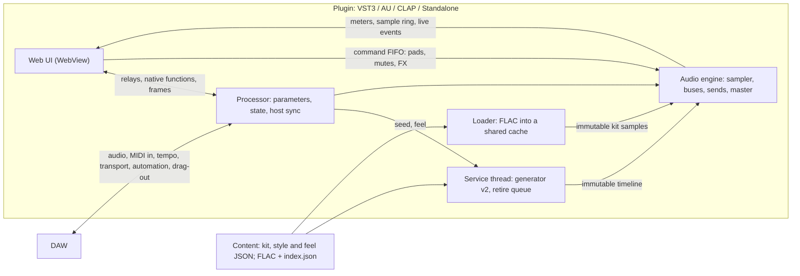

# Roadmap: Wubansia

**Wubansia** is the product name (identity in ADR 0002). The direction was reset on 2026-10-29 (ADR 0005). The current step's plan, in full detail: [`docs/plans/S1-futuristic-slice.md`](plans/S1-futuristic-slice.md).

## 1. What we're building

Wubansia is a VST3/AU/CLAP instrument plus a standalone app for futuristic club music. It plays groove kits in time with your DAW in four directions: sci-fi club, future garage / 2-step, hyper-clean future house, and dark industrial / techno. A new generator (v2) writes a whole track per seed, and an extended mix of it, with MIDI that should sound programmed by a person, not by a machine. It has its own effects, a UI that looks like lit hardware, and it exports MIDI and audio.

Four goals, tested together on one kit before anything scales:
1. cool futuristic samples, rendered natively per kit
2. MIDI that isn't written like AI
3. effects
4. an impressive, fun UI that is also pro and slick

**v1 in one sentence:** open the plugin in your DAW, and it can do all of this:
- pick a kit in one of the four directions, and a seed for a new track
- play it in sync, launching sections and effects from pads or a keyboard
- reshape it with a few macro knobs and sends
- drag the MIDI or audio into your project

**Not in v1:** hosting other plugins inside it, AAX/Pro Tools, iPad, accounts or cloud sync, the 43 classic kits (they stay in the web app), and Windows until you ask for it.

### What already exists (and what happens to it)

| Today | Size | Becomes |
|---|---|---|
| The M0 plugin: JUCE 9.0.4, VST3/AU/CLAP/Standalone, CI with pluginval and auval | — | The shell S1 builds on |
| `core.js`: 43 kits as data (UKG 8, MTH 8, SG 8, CH 8, GH 4, GV 3, TH 4), the pattern compiler, full-song and extended-mix builders, a MIDI file writer. Deterministic (seeded PRNG). | ~3,600 lines | Frozen as a test baseline: a hash manifest, expected metrics and listening condition L (S1b). Not ported (ADR 0005). |
| `app.js`: WebAudio engine. about 30 synth voices, a multisample player with 13 instruments, a sidechain bus, reverb/delay, visualizers, the kit/song UI, pack zips | ~2,400 lines | A reference for the engine, effects and UI (the swell reverb, the echo voicing, `hitPad`, `drawSong`). Not ported. |
| ~840 sounds (drum hits, multisampled basses/keys, loops, FX, vocals) as FLAC, 44.1 kHz / 16-bit | ~200 MB | Stay in the web app. Not re-rendered: each new kit is rendered natively. |
| 48 Python sound-design and vocal scripts (numpy, pedalboard, Kokoro TTS, Whisper checks) | — | The starting point for `tools/sound` (48 kHz from the start) and the vocal chain |
| Validators (in key, note ranges), jsdom smoke tests, bit-exact checks | — | `golden_check` on the legacy baseline, and the C++ metrics |
| Decent Sampler + SFZ instrument library (already delivered) | — | Stop-gap that plays the old sounds in a DAW today |

## 2. Decisions (revised 2026-10-29, ADR 0005)

| Decision | Default | Why | Revisit if |
|---|---|---|---|
| Framework | **JUCE 9.0.4, CMake**, started from the **Pamplejuce** template (ADR 0001) | The most documented plugin framework. Builds VST3, AU and standalone from one codebase. | — |
| Formats | **VST3 + AU + Standalone**, **CLAP** via `clap-juce-extensions` | VST3 covers Ableton, FL Studio, Cubase, Bitwig and Reaper; AU is required for Logic. JUCE 9 doesn't author CLAP natively yet. | You use Pro Tools (add AAX later). |
| Platforms | **macOS universal (Apple Silicon + Intel) only, for now**; Linux built in CI only | You only need macOS (ADR 0004 update). The Windows build setup stays in place. | You ask for Windows. |
| UI | **WebView UI** (JUCE's WebBrowserComponent, WKWebView on macOS), TypeScript + Vite, lit hardware with pro restraint, a native drag strip as fallback | Fast to iterate on, and the same WebKit as Safari, so the UI can be checked outside the DAW. | The S1f spike shows WebView problems in your DAW. |
| Generator | **Generator v2** (`core/gen`): new, deterministic, integer-only, counter-based RNG. `core.js` is frozen as a test baseline. | The legacy generator reads as machine-made (4-bar loops, one swing per kit, fills on bar 8 of 8), and a port would reproduce that. In C++ it plays with the window closed and is real-time safe. | The blind rounds fail. For the classic kits, QuickJS is the escape hatch. |
| Sounds | **Per-kit native renders** at 48 kHz / 24-bit from `tools/sound`, each kit with its own DNA. A core set first, full depth after a listening sign-off. Vocals through 48 kHz resynthesis (D4). | Rendered, never upscaled. One DNA per kit keeps it sounding like one kit. | You want 96 kHz masters. |
| Effects | **Our own effects** on JUCE `dsp` building blocks: an FDN space with shimmer, a tape echo, the chord-tracking Alloy resonator, bus inserts, macros, performance pads | Effects are one of the four goals. Freeverb is generic, convolution costs too much CPU, and chowdsp's DSP is GPLv3. | — |
| Time-stretch / pitch | **Signalsmith Stretch** (MIT), in M3, only where slicing doesn't cover | S1 avoids it: robot phrases are sliced to the grid and risers are end-aligned. | — |
| Content | FLAC per sound + `content/index.json` in git; audio **outside git**, per kit, in GitHub Releases | Repo stays small; each kit has its own version, and state stores it. | — |
| JUCE license | **Starter** (free) while revenue is under JUCE's threshold, then Indie/Pro; or AGPLv3 if the project is open source | Starter costs nothing up front. | Before selling: check current terms on juce.com. |

## 3. Architecture

Plugin-native and "render first" (ADR 0006): everything that ships is C++ (plus the WebView UI) from the start, and every goal gets an early check through files before the plugin plays. Detail in the plan's §3.



### Components
- **Groove core (`core/`)**: generator v2. Pure C++20, no JUCE, and no floating point in any decision or timing (it runs off the audio thread). Input: kit, style, feel, seed, options. Output: an immutable Timeline (performed events, the quantized score, sections, CC curves, fills, slices), Standard MIDI Files and metrics. Same inputs give the same bytes on every platform.
- **Audio engine (`engine/`)**: everything that makes sound.
  - Kit loading into a shared cache; the sampler (16-tap sinc, zones, layers, round robins, loops, choke, slices, P-center); the reese lane voice.
  - Scheduling: ticks to samples, loop wrap, Jam and Song modes.
  - Four buses with pump, filter, drive and crush; the Space, Echo and Alloy resonator sends; a master with filter macro, widener, glue compressor and limiter; performance FX.
  - The same engine renders offline for listening rounds, stems and tests.
- **Processor (`plugin/`)**: JUCE `AudioProcessor`.
  - Reads the host playhead (tempo, PPQ position, play state, loop region).
  - Owns the parameters (automatable, stable IDs), the saved state (versioned, with migrations; v2 stores the seed, `gen_version`, the score, the kit ID and content version) and the service thread.
  - Owns the MIDI input: pads on notes 0–15, drums on 35–59, chops on 60–84.
- **UI (`ui/`)**: TypeScript + Vite, loaded into the WebView from assets compiled into the binary (no network). It talks to C++ only through `ui/src/bridge.ts`.
- **Content (`content/`)**: kit, style and feel JSON (+ JSON Schema; integers only for C++), lyrics and a sound index. Audio is installed to `~/Library/Application Support/Wubansia Audio/Wubansia/Content/`.

### Threads
- **Message thread:** UI and parameter changes. While the editor is open, a frame timer (60 Hz playing, 10 Hz idle, off when hidden) reads the meters and the sample ring and sends one `frame` event to the page.
- **Service thread:** owned by the processor, so it runs with the editor closed. It builds timelines ("latest wins") and publishes them through an atomic pointer swap: a new seed takes over at the next 4-bar line, a Feel change at the next bar. It frees the old timelines and kit samples that the audio thread hands back through a retire FIFO, and it starts kit loads.
- **Loader thread:** decodes the kit's FLAC files into a process-wide, reference-counted cache keyed by kit ID and content version, so instances share memory. Loading is staged (drums, perc and bass first), and each stage is published by atomic swap.
- **Audio thread:** maps the host position to song ticks (480 PPQ, 120 ticks per 16th) and schedules events sample-accurately into voices. It never allocates, locks, logs or does I/O. The one exception: in offline renders only, it may wait up to 30 s for the kit (D5).
- **FIFOs:** pads, mutes and FX go from the editor to the audio thread through an SPSC command FIFO. Meters come back through atomics, samples and live events through SPSC rings. Lane lights are scheduled in the page from the timeline.

## 4. Repo layout

```
CLAUDE.md
THIRD_PARTY_NOTICES.md  license notices for everything that ships
.nvmrc                  the pinned Node LTS (UI build, legacy baseline)
docs/ROADMAP.md, docs/decisions/NNNN-*.md, docs/listening.md, docs/midi-map.md
docs/plans/             step plans (S1-futuristic-slice.md)
legacy/web-pack/        original web app (core.js, app.js, build_site.py), its sound pipeline (audio/, inst/), manifests (out/), tests;
                        the reference and test baseline; audio comes from the web-pack-v21 release, see legacy/web-pack/README.md
content/kits/           FUT01.json + schema.json (C++ reads them: integers and strings only); FUT01.dna.json (Python only)
content/styles/         hand-authored style specs per direction (+ schema)
content/feels/          hand-authored feel templates per direction (+ schema)
content/lyrics/         vocal lines per kit, clean and R-rated
content/index.json      every sound: id, path, sha256, sr, bits, layer, rr, root, loop, gain, slices, pcenter, flags, tags
content/golden/         legacy-v21.sha256: hash manifest of the frozen legacy core.js output
libs/                   pinned submodules: JUCE, clap-juce-extensions, Catch2
cmake/                  our CMake helpers (identity, build defaults)
core/                   groove core (C++20): gen/, model/, midi/, metrics/ + tests
engine/                 audio engine: kit/, sampler/, sched/, fx/, perf/, render/ + tests
plugin/                 JUCE processor/editor, parameters, state, bridge
ui/                     TypeScript + Vite front end
cli/                    `groovecore` tool: gen, metrics, render
tools/sound/            48 kHz sound design: dsp48.py, recipes, kit scripts, render.py, qa.py, sheets
tools/legacy_audit/     metrics on the legacy baseline (pinned Node)
tools/listening/        blind listening player
tools/                  export_golden.js, fetch_content.py, content packer
tools/ci/               validator scripts used by CI and locally
.github/workflows/      build, test, pluginval/auval, (later) sign + notarize
```

## 5. Milestones

Sizes are relative: **S** = a session or two, **M** = several sessions, **L** = sustained iteration with listening tests. Each milestone ends with something you can try in your DAW or on the command line.

**Order (ADR 0005):** M0 ✓ → S1 → S2 → M3 → M4 → M5 → M6 → M7. S1 runs as steps, each on its own branch with its own PR.

### M0. Foundations [S]: done
Goal: an empty instrument that builds in CI and loads in your DAW.
- [x] Create the project from the Pamplejuce template. Pin JUCE as a submodule (latest stable 8.x or 9.x) and record the choice in `docs/decisions/0001-framework.md`. *(JUCE 9.0.4.)*
- [x] Set the company/product names, plugin codes and bundle IDs. Formats: VST3, AU, Standalone; add CLAP through `clap-juce-extensions`. *(ADR 0002.)*
- [x] Minimal processor: a sine voice on MIDI notes, one gain parameter, and state save/restore for it.
- [ ] CI on macOS and Windows: build, Catch2 tests, pluginval at strictness 10, auval on macOS, and upload of the plugin binaries. *(macOS and Linux green. Windows is manual-only and not yet run: deferred until you ask, see the ADR 0004 update of 2026-10-29.)*
- [x] Fill in the real build/test commands in `CLAUDE.md`.

**Done when:** CI is green on both platforms; pluginval and auval pass; you load the plugin in your DAW, play a note, save, reopen and get the same gain.

*Result, 2026-10-29 (macOS only):* CI is green on macOS and Linux, and pluginval and auval pass. You installed the macOS CI build and report "plug in works" in your DAW. Not reported: which DAW, which format (VST3, AU or CLAP), and the save/reopen gain check. Windows is deferred.

### S1. Futuristic one-kit slice [L]
Goal: test all four goals small, on one kit: FUT01 "Alloy Signal", sci-fi club × future garage / 2-step, 134 BPM, F# minor (11A), a core set of about 373 sounds. Plan: [`docs/plans/S1-futuristic-slice.md`](plans/S1-futuristic-slice.md) (§7 has the steps in full).
- [ ] **S1.0 Approve** [S]: ADRs 0005–0006, this roadmap, the exact `CLAUDE.md` diff, `docs/listening.md`, the plan. *You get:* this as a PR. *You check:* the `CLAUDE.md` diff, line by line. This box is ticked at the start of S1a, once the PR is merged.
- [ ] **S1a First listen, four kits** [M–L]: `tools/sound` with QA tests first (the mud gate included), the 48 kHz vocal chain, 12 sounds and a 4-bar context loop, dry and wet, per kit. Round 1 judged FUT01 alone; after it you asked for four kits, one per direction (ADR 0010, `docs/plans/S1-four-kits.md`): FUT01's fix round plus FUT02 "Orbit Relay" (sci-fi club, 130 BPM), FUT03 "Glass Current" (hyper-clean future house, 128 BPM) and FUT04 "Furnace Code" (dark industrial / techno, 136 BPM). *You get:* `s1a-listen` (round 1, done), the four kits on one listening page (round 2), and round 3, the modern production pass you asked for ("a cool modern sound ... that sounds like current house/garage/techno"): each kit's context loop remixed against the modern-sound standard (`docs/plans/S1-modern-sound.md`), a mastered "club" loop through the shared club master (ADR 0014, proposed), and each kit's loop as MIDI with a DJ-friendly extended mix in its genre's form (`content/midi/`). Then round 4, on your request: FUT01 rebuilt as current UK garage (2-step and speed garage) and FUT03 as garage-house / deep tech house, each with new core sounds, synth accents and synth phrases (the phrases also as MIDI), while FUT02 and FUT04 stay as round 3 (ADR 0015). Then round 5, after your round 4 listen ("sounds are very good, vocals suck, either ditch or rethink, need those cool accent synths"): every kit's text-to-speech vocals replaced by a wordless vox synth made by synthesis, each kit's loop as two club masters, with the vox synth and without, for you to choose between, the synth accents playing in every loop, and FUT02 and FUT04 given synth accents and phrases of their own (ADR 0016). *You check:* listening rounds 2 to 5; per kit, pass is ≥ 8 of 12 kept with Cool ≥ 4 after one fix round, a median Cool ≥ 4, and "one kit?" yes on ≥ 10; in round 3 also the raised master caps of FUT02-FUT04 and the crest the master may cost the hits (ADR 0014), FUT01's kick A or B and FUT04's kick on G1. Which kits go on to S1c is decided then.
- [ ] **v0.1 The four kits in the plugin, now** [L] (re-scope, ADR 0017, accepted 2026-11-11): after round 5 you asked for the plugin instead of more listening rounds ("give me the best version of it all in a plugin!"), so v0.1 comes ahead of S1b2-S1g. The four round 5 kits play their written MIDI (MIDI v2, ADR 0019) in sync with your DAW, through a C++ sampler with recorded phrase lanes (ADR 0020), the recipes' mix and a real-time club master (ADR 0021); with 30 parameters and state version 2 (ADR 0018), a native editor with MIDI drag-out, and the samples installed outside the plugin (ADR 0022). It takes S1d's sampler, scheduler, offline wait and `groovecore render`, S1e's mix and master, and S1g's parameters, state v2, Standalone transport, MIDI map and drag strip, and deletes `SineVoices`; the generator (S1b2), the core kit (S1c) and the WebView UI (S1f) keep their places, and their boxes are ticked only for what v0.1 really delivers. *You get:* the macOS CI zip and four per-kit content zips. *You check:* the approval items (the parameter IDs, state v2, deleting `SineVoices`, MIDI v2, phrase lanes, the real-time master, how the samples reach your Mac), then the DAW checklist.
  - [x] The approval items: your "Go" on the list, 2026-11-11 (ADRs 0017-0022 accepted).
  - [x] The build, integrated from its packages and checked on Linux: ctest, `golden_check`, the sound tools' tests, pluginval at strictness 10 (with and without content), TSan on the engine and the kit service, the real kits loaded from their content zips, and the fidelity report against the round 5 loops (`docs/listening.md`, v0.1).
  - [x] macOS: the CI zip, auval and pluginval on the AU, and the four content zips in your hands (CI at e48b3e0, 2026-11-11; you: "Sounds great", and the AU works in Logic Pro; Ableton Live 12 not checked yet).
  - [ ] Your DAW checklist (`docs/listening.md`, v0.1).
- [ ] **v0.2 Samples: hear and drag every kit's sounds** [M] (ADR 0024, proposed 2026-11-12): after v0.1 you asked to "pull specific samples out of the DAW plug-in" and to "select sounds from the plug-in; like cool accent synths or flair and drop them into my DAW", so v0.2 also comes ahead of S1b2, as v0.1 did. The header's **Samples** button opens a drawer over the lanes and FX with every kit's sounds in seven categories (FUT01-FUT04: 35, 37, 36 and 32 sounds, which reach all 618 files). A click plays the file dry at −6 dB over the groove; a drag copies the kit's own 48 kHz / 24-bit WAV, byte for byte, into `~/Music/Wubansia/Samples/<KIT> <Title>/` under a name that says what it is (`Rave Stab v2 - FUT01 134 F#m 11A.wav`), then hands it to the DAW. No new parameter or saved state, and offline bounces are unchanged. It is the first part of M6's sound browser. *You get:* the macOS CI zip of the v0.2 PR (the content zips are v0.1's) and `dist/INSTALL.md`'s "Samples into your DAW". *You check:* the DAW checklist.
  - [x] The defaults: you asked for it on 2026-11-11, and the spec's three defaults (dry samples now; the kit's own note spelling, with C4 as middle C; the Samples button opens the drawer) were announced to you; since 2026-11-18 they stand as built under ADR 0028 (your rule: build in, cut later). They can change until v0.2 ships; the file names freeze then.
  - [x] The build, checked on Linux: ctest, `golden_check`, pluginval at strictness 10 (with and without content), TSan on the auditions, the drawer and the services, the four kits' default files copied byte for byte from their content, and offline renders bit for bit as before (`docs/listening.md`, v0.2).
  - [ ] macOS: the CI zip, pluginval on the AU and `auval -strict`, in your hands.
  - [ ] Your DAW checklist (`docs/listening.md`, v0.2).
- [ ] **v0.2 Drums on one track** [S] (ADR 0025, accepted 2026-11-18 under ADR 0028): you asked for "an option to input the drum midis as a single drum rack midi" when you drag a whole song. A 1 drum track switch on the drag strip, off unless you light it and kept for your user, makes the Loop and Song drags bring their drums as one track, Drums (channel 10, the same notes), with every other instrument on its own track as before. Its choices (the switch's words, the "(1 drum track)" mark, the track's name `Drums`, off by default, Loop and Song only; ADR 0025) were announced to you and stand as built under ADR 0028; they can change until v0.2 ships, when the file names freeze. *You get:* it in the next macOS CI zip. *You check:* with the switch lit, in a new Live 12 set and a new Logic project (a drop writes over the tracks after it), drop a Song on a Drum Rack track and on a Drum Machine Designer track: the drums land on that track, the rest on the tracks after it (the drum option's items in v0.2's DAW checklist, `docs/listening.md`).
- [ ] **v0.3 Creative toolkit** [L] (ADRs 0027-0032, in under ADR 0028, 2026-11-18): you asked for "more midi's", a
  cooler UI with "more genre specific views", MIDI that works "with my own synths", "more 8 bar melodic samples"
  that "add to songs that are build using the midis and chords provided in teh app", the full extended mix "for
  just specific parts such as just pulling in the full extended midi for drum kits", and "drum kits I could pull out
  of the plugin into my daw"; then "all four genre looks in the plugin, each switching with its kit". v0.3 is a
  toolkit, not more finished songs: every piece is an option you can turn off or ask to cut, with no listening round
  and no approval gate. Plan: [`docs/plans/v0.3-plan.md`](plans/v0.3-plan.md). *You get:* each part in the next
  macOS CI zip as it lands, with a screenshot of each look at the end. *You check:* nothing before it ships; when you
  use it, what to keep and what to cut.
  - [x] For my synths (ADR 0027): the bass up an octave, no note under a 16th, no overlaps, soft notes at 72 (in the macOS CI zip of `9d4c1b1`).
  - [x] Chords as chords (ADR 0027, amended): a chord sample's track becomes the whole chord its sample plays,
    voiced as the kit voices it and lifted above the For my synths bass.
  - [ ] The Phrases drawer (ADR 0031): the header's Phrases button, the kit's own phrases and lead line there, off
    the drag strip.
  - [ ] Part drags (ADR 0029): All, Drums, Bass, Chords, Lead, Vox or Accents for Loop and Song, the whole 224 bars
    with tempo, key and markers; Drums with 1 drum track is one track for your drum rack.
  - [ ] Drum kits (ADR 0030): the Drum kit button saves the playing kit's drums as a folder: a WAV per pad, every
    layer and round robin, an SFZ file and a README.
  - [ ] Phrases (ADR 0031): 64 eight-bar phrases per kit over its own chords, in eight kinds; click to hear one with
    the groove, drag it, More for 8 new ones, a star to keep one.
  - [ ] Four looks (ADR 0032): night bus, mission HUD, deep glass and machine room, each switching with its kit,
    every light real, fonts built in.
  - [ ] The build, checked on Linux: ctest, `golden_check`, pluginval at strictness 10, the TSan subset, the drum
    kits from real content; macOS: the CI zip with auval and pluginval on the AU.
- [ ] **S1b1 Generator, part 1** [M]: the legacy baseline and the metric suite first; then RNG, harmony, rhythm, feel, the SMF writer, `groovecore gen` and `metrics`, for all four kits, each a style and a feel as data (ADR 0013). *You get:* 10 seeds per kit as DJ-friendly extended mixes delivered as MIDI regions (the whole arrangement with a marker at each section, one file per section and `regions.json`, with feel and quantized): drums, bass, chords and FUT02's arp, with builds that roll up into the drops; and a metrics report against legacy. *You check:* an optional skim.
- [ ] **S1b2 Generator, part 2** [M]: form grammar, hook, motifs, fills, CC lanes, full songs; snapshot parity on macOS arm64. Every full song is a DJ-friendly extended mix (a 32-bar mix-in from drums only, a 32-bar mix-out back to drums), delivered as MIDI regions: the whole arrangement with a marker at each section, one file per section and `regions.json`, the format S1b1 built (ADR 0013), with each region's one-bar dropouts since S1b2a (ADR 0023 §6). Also the rest of the plan's rhythm stage (syncopation bands per energy level, the displacement and ratchet operators), and the gating ADR's decisions ADR 0013 leaves open: the lanes' swing tiers against round 1's "every lane uses the kit's one swing" (G8), G7 per track, G1/G2 for one-chord styles, G5's ghosts, whether G4 gets a ceiling, and G9's rarity rule for perc cycles. From part 1's reviews: FUT01's reese drop layer, a per-seed arp motif for FUT02 (R10 lead at most 3%), lane moves inside the drops, and drop and break starts drawn on the 8-bar grid (ADR 0013 §2 lists them). *(S1b2a, the first of the four steps in `docs/plans/S1b2-plan.md`, delivered the form grammar, ADR 0023 (proposed): each seed draws its own extended mix from its style's grammar, lanes move inside the drops, and drop and break starts sit on the 8-bar grid, about 70% on 16-bar lines; G10 passes on all four styles. S1b2b, the hook and motifs (`docs/plans/S1b2b-plan.md`, ADR 0026, accepted 2026-11-15), has its steps 1 and 2 done: the generator's MIDI on the channels Wubansia plays (the bass on 1, the lead on 2), and one hook per seed on a lead lane in every kit (FUT02's arp carries it), placed over the drawn forms as the kits' written mixes place theirs; G4 and G5 now pass for the leads (FUT04 still fails G5 on its ghosts), and FUT02's cross-seed duplicate 2-bar motifs fell from 7.1% to 0.8%. Its step 3, drop 2's own bass lines and FUT01's bass talk, is next; its step 4, the vox reply, can follow now that the vox synth stays (ADR 0016). Both wait while v0.3, the creative toolkit you asked for, comes first. The fills and the rhythm stage, and the gating ADR with the deliverable remain, and plan §2.3's 4+4 false drop and per-seed drop 2 are the lead's call under ADR 0028.)* *You get:* `s1b-midi`, 10 seeds as full songs (with feel and quantized), `docs/midi-map.md` (with the generator's `regions.json`, its blocks and dropouts). *You check:* optional and unrated.
- [ ] **S1c The core kit** [M]: about 40 title-checked candidate vocal lines for you to pick from (on hold until you choose between round 5's vox synth and no vocals, ADR 0016); then the 373-file render behind the QA gate, `index.json`, packing, `fetch_content.py`. *You get:* `content-fut01-v1` and a kit tour. *You check:* round 2 per instrument, and the clean and R-rated vocals.
- [ ] **S1d Hear it, dry** [M–L]: real-time, TSan, no-editor, block-size and host-sync tests first; then the sampler, scheduler, offline renderer, `groovecore render` and the blind player. *(v0.1 delivered the sampler, scheduler, offline wait and `groovecore render`, with their real-time, TSan, block-size and host-sync tests; the blind player and blind session 1 remain.)* *You get:* `s1d-blind-1`. *You check:* blind session 1 (pass rule in §8).
- [ ] **S1e Effects** [M]: effect tests first; then the buses, Space, Echo, the Alloy resonator, the master, macros and performance FX. *(v0.1 delivered the four kits' mixes, Space, Echo, the resonator, the club master and the three macros, ADR 0021; performance FX, the effects sign-off and blind session 2 remain.)* *You get:* `s1e-fx` and `s1e-blind-2`. *You check:* the effects sign-off, and blind session 2 on another day.
- [ ] **S1f See it: UI + WebView spike** [M]: Playwright tests first; then `ui/` on a mocked bridge, and a spike plugin with a WebView, one parameter with gestures and MIDI drag-out. *You get:* the mock UI page (open it in Safari) and a macOS CI zip of the spike. *You check:* the look; in your DAW, the spike loads, knob and automation move each other, and a `.mid` drags onto a track.
- [ ] **S1g Play it in your DAW** [L]: parameter, state v1→v2, real-time and host-sync tests first; then the processor-owned services, 8 parameters frozen and `SineVoices` deleted (both need your approval), state v2, the Standalone transport, the MIDI map and the drag strip. *(v0.1 delivered all of these, with 30 parameters instead of 8 (ADR 0018), and the content zips and their installer in place of `fetch_content` for now (ADR 0022); the macOS zip in your hands and your DAW checklist remain.)* *You get:* a macOS universal CI zip plus `fetch_content`. *You check:* the DAW checklist (plan §5.6 E).
- [ ] **S1h Tune and sign off** [S–M]: one fix round from your notes; tune feel, macros and the effects preset; freeze the generator snapshots. *You get:* the final build and renders. *You check:* the final sign-off on all four goals, and go or no-go for S2.

**Done when:**
- all 373 core sounds pass sample QA, the mud gate included
- the generator passes the 10 gating metrics and its snapshots match on Linux and macOS
- the real-time, render and plugin tests pass, with pluginval and auval
- both blind sessions pass the rule in §8
- you've played it through the DAW checklist and signed off all four goals in `docs/listening.md`

### S2. Depth and two more directions [L]
Goal: prove the generator and the sound pipeline generalize. Planned in detail after the S1h go.
- [ ] FUT01 at full depth (1,145 files: more round robins, 2-semitone zones, 12 + 12 phrases), if the S1h go asks for it. Playing it needs packed or streamed samples (M3).
- [ ] (c) Hyper-clean future house at 128 BPM: 3-layer phase-locked drums, supersaw and pluck multisamples. Its first listen is FUT03 in S1a (ADR 0010); S2 takes it to full depth.
- [ ] (d) Dark industrial / techno at 136 BPM: the 8× kick chain, noise, modular blips, and acid as the first real-time engine voice (a ZDF diode ladder, tested against the Python model). Its first listen is FUT04 in S1a (ADR 0010); S2 takes it to full depth.
- [ ] A style spec and a feel template for each direction, and a kit switcher in the UI.

**Done when:** both new kits pass the same gates as FUT01 (sample QA with the mud gate, the gating metrics, a blind round), and you sign them off in `docs/listening.md`.

### M1. Bring the current pack in [M]: mostly dropped (ADR 0005)
The two done items stay. The rest was dropped or moved:
- [x] Import the web app, its Python pipeline, manifests and tests into `legacy/web-pack/`. Paths are relative (`PACK_ROOT`), and `build_site.py` rebuilds the published page byte-for-byte. Audio is in the `web-pack-v21` release.
- [x] Pin the Python pipeline's requirements (`legacy/web-pack/requirements.txt`).
- Kits out of `core.js` into JSON: dropped, because the kits aren't ported.
- `tools/export_golden.js`: moved to S1b1, original keys only (516 files, a hash manifest, no MIDI committed). Transposed goldens are dropped.
- Splitting the FLAC sprites: dropped. The old library stays in the web app.
- The content bundle and `tools/fetch_content`: moved to S1c, per kit.

### M1b. HD re-render of the old library: dropped (ADR 0005)
Every new kit is rendered natively at 48 kHz / 24-bit, and the old library stays at 44.1/16 for the web app. The master spec, oversampling rules, QA, spectrogram sheets and index fields move into S1a and S1c. Velocity layers and round robins are part of each new kit. D4 settles the vocal question.

### M2. Port `core.js` to C++: dropped (ADR 0005, D2)
Generator v2 (S1b) replaces it, and `core.js` is a frozen test baseline. If the classic kits are ever wanted, embedding `core.js` through QuickJS is cheaper than a byte-exact port. The validators become the S1b metrics. The parity pitfalls that were listed here stay in CLAUDE.md.

### M3. Engine hardening [L]
Goal: Wubansia holds up across hosts, several kits and your Mac. Web-parity renders are dropped.
- [ ] Host test matrix in the DAWs you use, in AU, VST3 and CLAP: tempo ramps, loop wrap, jumps, start mid-bar, offline bounce.
- [ ] The RTSan run in CI, as ADR 0001 D5 promised (clang 20 comes with the host matrix).
- [ ] Packed 24-bit or streamed samples, and a memory budget for several kits at once (FUT01 full depth needs it).
- [ ] Signalsmith Stretch where slicing doesn't cover.
- [ ] Multi-out: stereo outputs for drums, bass, music, vocals and FX.
- [ ] CPU and RAM measured on your Mac.
- [ ] clap-validator blocking on all OSes once clap-juce-extensions PR #193 lands (ADR 0004).

**Done when:**
- the realtime sanitizer is clean on the audio thread
- playback stays in time across the host matrix while the DAW loops and jumps
- CPU and RAM stay within budget on your Mac with several kits loaded
- clap-validator passes

### M4. UI v1 [M–L]
Goal: the S1 panel grows into the full UI. The WebView spike, MIDI drag-out, parameters and state v2 already arrive in S1f and S1g.
- [ ] A browser across directions and kits (the S2 kit switcher grows into it).
- [ ] A resizable editor and a light theme.
- [ ] Per-bus knobs in the Mix drawer: pump, filter, drive, crush.
- [ ] Effects presets and scene presets.
- [ ] Polish from your S1 and S2 notes.

**Done when:** in your DAW you can browse every kit in every direction, resize the editor, switch themes, and reopen the project with the same state, all with no internet connection.

### M5. Make it dynamic [L]
Goal: from one track per seed to an instrument that keeps producing new ideas. Sections, pads, macros and the variation engine already arrive in S1.
- [ ] Lane locks and "mutate this bar/section", cheap with the counter RNG. Seeds are saved in state.
- [ ] Generator controls: density, syncopation, energy, fill rate, humanize. All automatable.
- [ ] Change key: play and export a track in a key other than the kit's own (FUT01 is in F# minor).
- [ ] "New kit": new MIDI from a seed in each direction, over the shipped sound sets.
- [ ] DNA variants: new sound sets made offline from a kit's DNA, shipped as content.
- [ ] Generated tracks keep passing the gating metrics and the blind rule. Keep the listening log in `docs/listening.md`.

**Done when:** you can perform a whole track from a MIDI keyboard (sections, pads, macros) and record it in the DAW, and "new kit" in any direction regularly gives you something worth keeping.

### M6. Producer workflow [M–L]
- [ ] Sound browser: tags and search, auditioning in sync and in key, favorites (the crate), drag audio out. *(v0.2 brings a first one, ADR 0024: every kit's sounds by category, dry auditions, and drag audio out, one WAV per drag, byte for byte. Tags and search, auditioning in sync and in key, favorites, renders "as heard in the kit" with its Space and Echo, multi-file drags, and root and tempo tags in the WAVs remain.)*
- [ ] Export:
  - MIDI per lane, section or song
  - audio stems and full mix via the offline renderer
  - filenames that carry BPM, key and Camelot
- [ ] Extended mixes: a longer, DJ-friendly version of a seed's track, to play and to export.
- [ ] Presets: factory (curated kits and seeds per direction) and user presets, a preset browser, import/export.
- [ ] Arrangement editor: reorder and resize sections, toggle lanes per section, save as a preset.

**Done when:** you can go from a kit to stems in your DAW in under a minute, and presets survive a reinstall and move between machines.

### M7. Release [M]
macOS first; Windows when you ask.
- [ ] Installers:
  - signed and notarized macOS package
  - signed Windows installer, once Windows is back in scope
  - content installed, or downloaded on first run, versioned and repairable
- [ ] Manual, changelog and a site. If the current web app becomes the demo, first rename its artist-styled families (`legacy/web-pack/app.js:13-15`) to plain genre names (section 9).
- [ ] If selling: license keys, EULA, store and pricing.
- [ ] Optional: AAX for Pro Tools (needs Avid's developer program and PACE signing).

**Done when:** a clean Mac can install, open the plugin in Ableton, Logic and FL Studio, and uninstall cleanly. A clean Windows PC too, once Windows is back in scope.

## 6. After v1
- Compile the groove core to WebAssembly so the web app and the plugin share one engine.
- A MIDI-only variant (AU MIDI FX for Logic, VST3 MIDI out where hosts allow) to drive your own synths.
- AUv3 for iPad.
- More directions and kits; the 43 classic kits through QuickJS, if you want them.
- Kit from text: describe a kit, generate kit JSON (e.g. with the Claude API), validate it, audition it.
- Sharing user kits.

## 7. Risks and spikes

| Risk | Mitigation | When |
|---|---|---|
| The MIDI still sounds machine-made, or we tune to the metrics (Goodhart) | Only 10 gates, with the bands of plan §5.1 (G3, G4 and G8 one-sided; two-sided bands are for the S1b2 gating ADR); the hook and the form grammar; blind rounds with absolute floors and pre-registered seeds; the N0 ablation; the S1d gate before effects polish | S1b–S1d |
| The sounds aren't "cool", or don't sound like one kit | S1a gates on Cool ≥ 4, not just "kept"; a commercial reference track; A/B characters; a wet context loop; one alloy and one voice blend | S1a, S1c |
| Muddy low end (your feedback on the prototypes) | The mud gate on every kick, bass, tom and boom, on single hits and a 2-step loop; about 100 Hz high-pass on everything else with low end | S1a onward |
| Kokoro hasn't run in a cloud session yet | Resolved in S1a: Kokoro and Whisper run in the cloud session (sherpa-onnx), seeded per take. If a later session can't download the models, the vocal steps run on your Mac through Remote Control. | S1a |
| WKWebView misbehaves in your DAW (focus, first click, the reload on every open) | The S1f spike before integration; `withInitialisationData`, so the page never flashes defaults; the native placeholder | S1f |
| Drag-out from the WebView fails | The native drag strip | S1f |
| RAM and load time | About 206 MB as float32 for the core set; staged loading; the shared cache; full depth only after the go, with M3's packing | S1c, S1d, M3 |
| CPU on Apple Silicon is unknown | Sampler and effects benchmarks on macos-15; budgets of 6% + 6% within 15%; a cap of 64 voices | S1d, S1e |
| macOS renders drift with Accelerate or libm updates | macOS is checked by tolerance; exact hashes on Linux only | S1d |
| Reported latency (about 68 samples) and the Bitwig CLAP bounce stall (clap-juce-extensions #184) | Use the VST3 in Bitwig until it's fixed; the latency is constant and tested | S1e, S1g |
| Host quirks (loop wrap, tempo ramps, AU validation) | Host-sync tests in S1d; the host matrix in M3; auval and pluginval in CI | S1d, M3 |
| Parameter IDs and state become permanent once projects are saved (ADR 0002) | Provisional names until the S1g freeze; state v2 with a migration test; the score stored in state | S1g |
| Content rules (R-rated lines, title collisions, artist names) | A title check before the S1c render; you pick the lines; Whisper plus the slur and name denylists | S1c |
| Scope creep | The plan's out-of-scope list and cut order (§2.7); every step ends with a check you make | All of S1 |
| macOS CI cost | Draft PRs until ready; three dispatched checkpoints; about $10–20 for S1 | All of S1 |
| Legal: artist names, dependency licenses | See section 9 | Before any public release |

What a cloud session can't verify (how it sounds, the plugin in your DAW, WKWebView timing, CPU on your Mac) is listed in the plan's §9.

## 8. Testing
- **Unit (Catch2):** generator stages, the RNG, the integer-only JSON reader, the MIDI writer, scheduler math, effects.
- **Legacy baseline ("golden"):** `golden_check` regenerates the 516 legacy MIDI files from frozen `core.js` with the pinned Node, checks them against `content/golden/legacy-v21.sha256`, and asserts that they fail every gating band on its primary set, with the values in `core/tests/legacy_expected.json` (exactly, but for DFA alpha's ±1 in thousandths). The manifest and `core/tests/legacy_expected.json` are never regenerated to make a test pass; fix the metric code.
- **Generator snapshots, not goldens:** `core/tests/snapshots/gen.sha256` holds the SHA-256 of every file `groovecore gen` writes for 16 seeds × {feel, quantized} × the four kits (1,372 files since S1b2a's drawn forms), identical on Linux x86_64 and macOS arm64: the macOS CI job runs both snapshot tests on every ready (non-draft) pull request to main, S1b1's included, and a mismatch there is fixed in the code, never in the manifest. S1b2's dispatched checkpoint adds the x86_64 slice under Rosetta. Each regeneration goes in its own commit until they are frozen in S1h. After that, a change needs a reason, and an ADR note if it is musical.
- **Gating metrics:** 10 gates on 64 seeds, with the bands of plan §5.1 (G3's are ceilings, G4's and G8's floors; two-sidedness is for the S1b2 gating ADR); the bands of G3, G5, G6 and G7 are pinned at every edge, in the C++ and the Node audit alike (G1–G10: progression diversity, harmonic rhythm, one-bar repetition, phrase-aligned changes, velocity resolution, chord velocities, microtiming, per-lane swing, fills, form diversity). The rest are reported, not gated. Invariants: same seed, same bytes; kick and bass within 2 ticks; in key; the hook placed; 128 bars in under 50 ms. Plan §5.1.
- **Sample QA (`tools/sound/qa.py`):** format, true peak, DC, clicks, tails, seams, aliasing, stereo low end, tuning, velocity steps, loudness, reproducibility, and the content denylists with Whisper. Plan §5.2.
- **The mud gate (your rule):** for kicks, basses, toms and the 2-step boom, the 150–400 Hz band falls 30 dB within 120 ms, stays at least 20 dB under 30–120 Hz after the first 80 ms, and is at most −12 dB of the sound; 400 Hz–1 kHz falls 30 dB within 150 ms. Pads, stabs, textures and chops are high-passed at about 100 Hz. Checked on single hits and on a 2-bar 2-step loop.
- **Audio renders:** exact hashes on Linux CI. On macOS, identical across runs and block sizes, and within tolerance of Linux (null residual, ±0.1 LU, per-band spectrum). Our mixing and gain code uses plain scalar loops, and a grep test bans `FloatVectorOperations` and the `AudioBuffer`/`AudioBlock` gain helpers in `engine/` (plan §3.5; its ADR isn't written yet).
- **Real-time:** an allocation counter and lock interposition around the full chain, TSan stress on timeline and kit swaps, and a no-editor test. RTSan comes in M3.
- **Plugin:** pluginval (strictness 10) on the VST3 and the AU, auval on macOS, clap-validator report-only (ADR 0004).
- **UI:** Playwright (WebKit) against `ui/` with a mocked bridge, and one bridge contract schema checked by Playwright and by a C++ test.
- **Listening (`docs/listening.md`):** blind rounds of L (legacy), N (new) and N0 (new, feel off) on 6 pre-registered seeds, loudness-matched. Pass: N's median beats L's by at least 1 on "programmed by a person?" and "stays interesting"; N ≥ N0 on "makes me want to move"; N's median ≥ 5 on both, with no seed below 3. Plan §5.6.
- **You:** the DAW checklist per step (plan §5.6 E), plus the listening log.

## 9. Licenses and legal (not legal advice)

| Component | License | Note |
|---|---|---|
| JUCE | AGPLv3 or commercial (Starter free under a revenue threshold, then Indie/Pro) | JUCE 9 kept JUCE 8's terms; check before selling. `juce_dsp` and `juce_gui_extra` come from the same pinned submodule. |
| `@juce-framework/webview` (from the JUCE submodule, a Vite alias, not npm) | AGPL-3.0-only OR LicenseRef-JUCE | Ships in the UI; covered by our JUCE licence |
| Third-party code bundled in JUCE | Zlib, libpng-2.0, IJG, BSD-3-Clause, MIT, MIT-Modern-Variant, ISC, Apache-2.0, FTL, Unicode-3.0, public domain | See `libs/JUCE/JUCE.spdx.json` and the file headers (FreeType and stb inside PlutoVG, json.h inside the VST3 SDK, HarfBuzz's `hb-ucd.cc`, Unicode data); notices in `THIRD_PARTY_NOTICES.md`. Re-check them when `juce_dsp` and `juce_gui_extra` are linked. |
| VST3 SDK | MIT (since VST 3.8, Oct 2025) | |
| CLAP, clap-juce-extensions | MIT | |
| Space Grotesk, JetBrains Mono, Doto (WOFF2) | OFL-1.1 | The only fonts that ship; notice in `THIRD_PARTY_NOTICES.md` |
| Signalsmith Stretch | MIT | M3 |
| Catch2 | BSL-1.0 | |
| Vite 8.3.5 | MIT | UI build only, never shipped |
| TypeScript 7.0.2 | Apache-2.0 | UI build only, never shipped |
| @playwright/test 1.64.1, with its WebKit build | Apache-2.0 | UI tests only, never shipped |
| Node (exact LTS in `.nvmrc`), `actions/setup-node` | MIT | UI build, legacy baseline and CI only |
| pluginval | GPLv3 | CI tool only, never shipped |
| clap-validator | MIT | CI tool only, never shipped |
| GitHub Actions (`actions/checkout`, `actions/upload-artifact`, `ilammy/msvc-dev-cmd`; `mozilla-actions/sccache-action`) | MIT; Apache-2.0 | CI only |
| Pamplejuce | MIT | Template; our build files, plugin sources, tests and CI started from it. License in `docs/third_party/pamplejuce-LICENSE` |
| pedalboard (Python), espeak-ng data | GPLv3 | Build-time sound design and vocals only, never linked into the plugin |
| Kokoro-82M weights / Whisper base.en | Apache-2.0 / MIT | Vocal render and QA, build time only |

Declined: three.js and PixiJS (too big), nlohmann/json (the integer-only reader replaces it), chowdsp (its DSP modules are GPLv3), and the Groove MIDI Dataset (the grooves must be ours). No new Python packages or C++ libraries.

- Content rules carry over from the pack: everything is original, with no audio, melodies, lyrics or song titles from existing records. Vocal lines and kit names are title-checked before rendering.
- The legacy web app labels three families after artists (`legacy/web-pack/app.js:13-15`). Wubansia doesn't carry those titles over (ADR 0005): its directions have plain names, and artist names never appear in product, sound, file or preset strings. The web app keeps them only as a personal reference. If it becomes the public demo (M7), they get plain genre names first.

## 10. Working with Claude Code

- **Where to run it:**
  - Cloud sessions build, test and render everything in S1. macOS is proven by CI (ADR 0004), and you try the CI zips in your DAW.
  - Claude Code on your Mac (for example through Remote Control) can skip the CI round trip in S1g, and runs the vocal steps if the speech models can't be downloaded in the cloud.
- **Loop per step:** plan the step and approve the plan, write the tests first, implement, then run the step's checks. You do the DAW and listening checks; Claude Code ticks the boxes here, writes the listening log and writes an ADR for each decision.
- **What needs you:**
  - listening sign-offs and the blind sessions
  - the `CLAUDE.md` diff (S1.0), the vocal lines (S1c), the parameter freeze and the `SineVoices` deletion (S1g), and the go for S2 (S1h)
  - facts still open: your Mac's chip, RAM and macOS version, your DAW and its version, and your listening setup (plan §10.2)
  - an Apple Developer account when you distribute, and store and licensing decisions if you sell

**Kick-off prompt:**

> Read CLAUDE.md, docs/ROADMAP.md and docs/plans/S1-futuristic-slice.md. We're on S1: start the first unticked step. Propose the exact plan for that step first: files, the tests you'll write first, risks, and what I'll get and check. Wait for my OK, then implement on its own branch. Stop when the step's checks pass, open a draft PR, and tell me exactly what to listen to or try.
