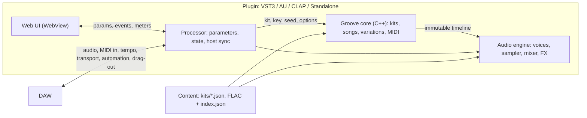

# Roadmap: from the web pack to a plugin

Working name: **UKG & Minimal Pack (plugin edition)**. Rename any time; nothing below depends on the name.

## 1. What we're building

The web pack is now a VST3/AU/CLAP instrument plus a standalone app. It plays groove construction kits in time with your DAW across seven genres: UK garage, garage house, minimal, speed garage, house, groove house and tech house. It builds full songs and extended mixes from each kit and can make new kits in each genre's style. It exports MIDI, stems and full mixes.

**v1 in one sentence:** open the plugin in your DAW, and it can do all of this:
- pick a kit or generate a new one
- play it in sync, launching sections from a keyboard
- reshape it with a few macro knobs
- drag the MIDI or audio into your project

**Not in v1:** hosting other plugins inside it, AAX/Pro Tools, iPad, accounts or cloud sync.

### What already exists (and gets reused)

| Today (web pack) | Size | Becomes |
|---|---|---|
| `core.js`: 43 kits as data (UKG 8, MTH 8, SG 8, CH 8, GH 4, GV 3, TH 4), the pattern compiler, full-song and extended-mix builders, a MIDI file writer. Deterministic (seeded PRNG). | ~3,600 lines | `content/kits/*.json` + `core/` (C++ port, tested byte-for-byte against the original) |
| `app.js`: WebAudio engine. about 30 synth voices (donk, reese, organ, stab, fmpluck…), a multisample player with 13 instruments, a sidechain bus, reverb/delay, visualizers, the kit/song UI, pack zips | ~2,400 lines | `engine/` (audio) + `ui/` (the same look, running in the plugin's WebView) |
| ~840 sounds (drum hits, multisampled basses/keys, loops, FX, vocals) as FLAC, 44.1 kHz / 16-bit | ~200 MB | `content/` library, re-rendered in HD (M1b), one FLAC per sound + `index.json` |
| 48 Python sound-design and vocal scripts (numpy, pedalboard, Kokoro TTS, Whisper checks) | — | in `legacy/web-pack/audio` and `inst` now; they become `tools/` and the HD renderer in M1b |
| Validators (in key, note ranges), jsdom smoke tests, bit-exact checks | — | the C++ test suite and golden files |
| Decent Sampler + SFZ instrument library (already delivered) | — | stop-gap that plays the sounds in a DAW today; replaced by the plugin |

## 2. Decisions (defaults; change them before M0 if you disagree)

| Decision | Default | Why | Revisit if |
|---|---|---|---|
| Framework | **JUCE 8.x or 9.x, CMake**, starting from the **Pamplejuce** template | The most documented plugin framework. Builds VST3, AU and standalone from one codebase. Pamplejuce already wires up Catch2 tests, pluginval, GitHub Actions, macOS notarization and Windows signing. | You want Rust (nih-plug) or a fully open stack. |
| Formats | **VST3 + AU + Standalone** first, **CLAP** via `clap-juce-extensions` | VST3 covers Ableton, FL Studio, Cubase, Bitwig and Reaper; AU is required for Logic. JUCE 9 doesn't author CLAP natively yet. | You use Pro Tools (add AAX later). |
| Platforms | **macOS (Apple Silicon + Intel) and Windows x64**; Linux built in CI only | Where the DAWs are. | — |
| UI | **WebView UI** (JUCE's WebBrowserComponent with native integration), reusing the current HTML/CSS/canvas design, with small native fallbacks | Keeps the look you already have and is fast to iterate on. Native fallbacks cover anything the WebView can't do (MIDI drag-out). | The M4 spike shows WebView problems in your DAW. |
| Generator | **Port `core.js` to C++** with golden tests | The plugin must play when its window is closed and must be real-time safe, so the generator can't live only in the UI. One deterministic core also lets the web app use it later via WebAssembly. | The port stalls; fallback is embedding QuickJS. |
| Time-stretch / pitch | **Signalsmith Stretch** (MIT) | Good quality, permissive license. | — |
| Content | FLAC per sound + `content/index.json`; audio **outside git** (GitHub Releases or Git LFS) | Repo stays small; content gets its own version. | — |
| Sound quality ("upscale") | **48 kHz / 24-bit masters re-rendered from the synthesis scripts**, plus velocity layers and round robins (M1b) | Almost every sound is synthesized, so re-rendering adds real detail; resampling the old files would only add size. | You want 96 kHz masters for extreme pitch-down work. |
| JUCE license | **Starter** (free) while revenue is under JUCE's threshold, then Indie/Pro; or AGPLv3 if the project is open source | Starter costs nothing up front. | Before selling: check current terms on juce.com. |

## 3. Architecture



### Components
- **Groove core (`core/`)**: pure C++20, no JUCE, no allocations promised (it runs off the audio thread). Input: kit, key, BPM, seed, options. Output: events, CC lanes, sections and Standard MIDI Files. Same inputs give the same bytes on every platform.
- **Audio engine (`engine/`)**: everything that makes sound.
  - Drum voices, the multisample sampler and synth voices ported from `app.js`.
  - Vocal and FX players.
  - Buses with sidechain ducking, sends (reverb, delay, swell reverb), drive, filter macro, master glue compressor and limiter.
  - The same engine renders offline for stems and tests.
- **Processor (`plugin/`)**: JUCE `AudioProcessor`.
  - Reads the host playhead (tempo, PPQ position, play state, loop region).
  - Owns the parameters (automatable, stable IDs) and the saved state (versioned, with migrations).
  - Owns multi-out buses and the MIDI input (keyswitches, pads).
- **UI (`ui/`)**: TypeScript + Vite, loaded into the WebView from assets compiled into the binary (no network). It talks to C++ only through `ui/src/bridge.ts`.
- **Content (`content/`)**: kit JSON (+ JSON Schema) and a sound index. Audio is installed to the OS's standard application-support folder.

### Threads
- **Message thread:** UI and parameter changes. It asks for a new timeline when the kit, key, seed or options change.
- **Worker thread:** the groove core builds the timeline and publishes it through an atomic pointer swap. The old timeline is freed back on the message thread.
- **Loader thread:** decodes the current kit's FLAC files into memory. The audio thread switches kits only when loading is complete, so there are no dropouts.
- **Audio thread:** maps the host position to song ticks (480 PPQ, 120 ticks per 16th) and schedules events sample-accurately into voices. It never allocates, locks, logs or does I/O.

## 4. Repo layout

```
CLAUDE.md
THIRD_PARTY_NOTICES.md  license notices for everything that ships
docs/ROADMAP.md, docs/decisions/NNNN-*.md, docs/listening.md
legacy/web-pack/        original web app (core.js, app.js, build_site.py), its sound pipeline (audio/, inst/), manifests (out/), tests;
                        audio comes from the web-pack-v21 release, see legacy/web-pack/README.md
content/kits/*.json     43 kits + schema.json
content/index.json      every sound: id, file, category, family, kit, key, camelot, bpm, bars, root, loop, gain, tags, explicit
content/golden/         reference MIDI + JSON event dumps exported from legacy core.js
libs/                   pinned submodules: JUCE, clap-juce-extensions, Catch2
cmake/                  our CMake helpers (identity, build defaults)
core/                   groove core (C++20) + tests
engine/                 audio engine + tests
plugin/                 JUCE processor/editor, parameters, state, bridge
ui/                     TypeScript + Vite front end
cli/                    `groovecore` tool: export MIDI, render WAV, validate
tools/                  Python sound design + vocals, content packer, golden exporter
tools/ci/               validator scripts used by CI and locally
.github/workflows/      build, test, pluginval/auval, (later) sign + notarize
```

## 5. Milestones

Sizes are relative: **S** = a session or two, **M** = several sessions, **L** = sustained iteration with listening tests. Each milestone ends with something you can try in your DAW or on the command line.

### M0. Foundations [S]
Goal: an empty instrument that builds in CI and loads in your DAW.
- [ ] Create the project from the Pamplejuce template. Pin JUCE as a submodule (latest stable 8.x or 9.x) and record the choice in `docs/decisions/0001-framework.md`.
- [ ] Set the company/product names, plugin codes and bundle IDs. Formats: VST3, AU, Standalone; add CLAP through `clap-juce-extensions`.
- [ ] Minimal processor: a sine voice on MIDI notes, one gain parameter, and state save/restore for it.
- [ ] CI on macOS and Windows: build, Catch2 tests, pluginval at strictness 10, auval on macOS, and upload of the plugin binaries.
- [ ] Fill in the real build/test commands in `CLAUDE.md`.

**Done when:** CI is green on both platforms; pluginval and auval pass; you load the plugin in your DAW, play a note, save, reopen and get the same gain.

### M1. Bring the current pack in [M]
Goal: one source of truth for kit data, and reference outputs to test the port against.
- [x] Import the web app, its Python pipeline, manifests and tests into `legacy/web-pack/`. Paths are relative (`PACK_ROOT`), and `build_site.py` rebuilds the published page byte-for-byte. Audio is in the `web-pack-v21` release.
- [x] Pin the Python pipeline's requirements (`legacy/web-pack/requirements.txt`).
- [ ] Move the 43 kits out of `core.js` into `content/kits/<ID>.json` and write `schema.json`. Change legacy `core.js` to load them; its output must not change.
- [ ] Write `tools/export_golden.js` to export, for every kit:
  - every MIDI file the web app exports (12 per kit) in the original key and two transposed keys
  - full song and extended mix
  - JSON event dumps for readable diffs
- [ ] Split the FLAC time-sprites into one FLAC per sound and write `content/index.json`, with checksums.
- [ ] Package content as a versioned bundle (GitHub Release asset or Git LFS), plus a `tools/fetch_content` script.

**Done when:** goldens regenerate byte-identically from legacy `core.js`; every kit validates against the schema; the index covers every sound.

### M1b. HD sound library: upscale everything [L] (runs alongside M2)
Goal: every sound re-made at studio resolution and with more variation, so the plugin's library holds up next to commercial packs.

"Upscale" here means re-rendering, not resampling. Nearly every sound in the pack is synthesized by the Python scripts at 44.1 kHz / 16-bit (`SR = 44100` in `audio/dsp.py`). Rendered again at a higher spec, they gain real detail; resampling the existing files would only make them bigger.

- [ ] ADR for the master spec:
  - 48 kHz / 24-bit FLAC
  - band-limited oscillators
  - oversampled nonlinear stages (drive, saturation, bit-crush)
  - dither only when exporting 16-bit
- [ ] Make sample rate and bit depth parameters of the pipeline (`dsp.py`, the writers, `render_inst.py`), and move it into `tools/`.
- [ ] Pilot: re-render one genre end-to-end (tech house) and compare old against new on spectrogram sheets (`tests/sheet.py`) and by ear before doing the rest.
- [ ] Drums:
  - 3–5 velocity layers, where velocity changes brightness, transient and pitch envelope, not just level
  - 3–4 round robins per hit
  - full natural tails
- [ ] Instruments:
  - sampled every 2 semitones, chromatic in the bass register
  - 3 velocity layers
  - round robins for plucks and stabs
  - crossfaded loop points with `smpl` metadata
  - release samples for keys
- [ ] Loops: re-render from the kit MIDI with the HD instruments, plus per-part stems.
- [ ] FX and transitions: re-render at the new spec with longer tails.
- [ ] Vocals: the TTS voice renders at 24 kHz, so vocals stop near 12 kHz and re-rendering alone won't fix them. Blind A/B per vocal, and keep the clean and R-rated versions:
  - a voice model that renders at 44.1/48 kHz
  - neural bandwidth extension (audio super-resolution)
  - the current "air" exciter
- [ ] QA:
  - peak and loudness targets per category, with a true-peak ceiling
  - checks for clicks, DC offset, loop seams and aliasing
  - spectrogram sheets and a listening log in `docs/listening.md`
- [ ] Derivatives, generated from the HD masters:
  - the 44.1 kHz / 16-bit set for the web app
  - a refreshed Decent Sampler/SFZ library
- [ ] Extend `content/index.json` with layers, round robins, sample rate and bit depth, and split the content bundle by genre if it gets large.

**Done when:**
- every sound in the index has an HD master that passes QA
- the pilot genre and a random sample of the rest are signed off by ear
- the web app rebuilds from the derivatives without regressions

Size note: 48 kHz / 24-bit alone is about 1.6× today's data. Velocity layers and round robins multiply that, so expect a few GB and per-genre downloads.

### M2. Groove core in C++ [M–L]
Goal: `core/` reproduces the web generator exactly.
- [ ] Notes, keys, Camelot, transposition (`noteNum`, `keyInfo`, `transposeFor`).
- [ ] The token parser and `compileDrums`/`compileMelodic`: velocity digits, holds, slides, `@Chord` tokens, swing warp.
- [ ] `buildSong` for every family form, including risers, breakdown progressions and gaps.
- [ ] `buildExtended`: layers, fills, perc, stabs, counter-melodies, strings, piano, vocal and shout rhythms, rewinds, tape stops, verb swells, sidechain CCs.
- [ ] SMF writer: type 1, track names, tempo, key and time signatures, CCs, pitch bends, lyrics.
- [ ] `groovecore` CLI: `export --kit TH01 --key 4A --song {loop|full|ext} --out file.mid`, plus `validate`.
- [ ] Port the validators (in-key %, note ranges, density) so generated kits can be checked later.

**Done when:** 100% of goldens match byte-for-byte in CI on both platforms, and an extended mix generates in well under 50 ms.

**Parity pitfalls (read before porting):**
- JS `Math.round` rounds .5 up, so `Math.round(-2.5)` is −2. Use `floor(x + 0.5)`, not `std::round`.
- `Math.imul`, `>>> 0` and `| 0` mean 32-bit wraparound. Use `uint32_t`/`int32_t` (`hash32`, `mulberry`).
- `Array.prototype.sort` is stable, and with no comparator it sorts as strings. Use `std::stable_sort` with the same comparator.
- JS object key order is insertion order, except integer-like keys, which come first in ascending order. Mirror the iteration order exactly.
- Keep `double` wherever JS used numbers, and keep the same operation order. If a mismatch is off by one velocity unit, suspect `pow`/`exp` differences at a rounding boundary.
- Strings in MIDI (track names, lyrics) are UTF-8 via `TextEncoder`.

### M3. Audio engine v1 [L]
Goal: any kit's loop and songs play in sync with your DAW and sound like the web version.
- [ ] Host sync:
  - tempo, PPQ position, play/stop, time signature
  - jumps when the DAW loop region wraps
  - sample-accurate scheduling within each block
- [ ] Timeline handoff from the worker thread (atomic swap) and per-kit sample loading on the loader thread.
- [ ] Drum voices: velocity curve, per-lane gain/pan (the `MIX` table), open/closed hat choke, and the per-family lane maps (`LANE_HIT`).
- [ ] Sampler: the instruments sampled every minor third play from the nearest root with pitch shift. Also:
  - loop points from the WAV `smpl` chunks, and release envelopes
  - the velocity-driven filter (`vfilt`) and the talking-bass filter
  - sends and the swell reverb (the `SAMPLER` table)
- [ ] Synth voices from `app.js`. Port the ones the kits use first, listed in `docs/engine.md` as you go.
- [ ] Buses and FX:
  - sidechain duck depth and recovery per family
  - reverb and delay sends, drive, filter macro
  - master glue compressor and limiter
- [ ] Vocal shots, risers and impacts for extended mixes, time- and pitch-matched with Signalsmith Stretch. Pre-render them on kit, key or tempo change, never on the audio thread.
- [ ] Offline renderer (same engine) and `groovecore render` for tests and stems.
- [ ] Reference renders of every kit loop from the web version (headless Chromium), for A/B comparison. Prove parity on the current library first, then switch to the HD library from M1b.

**Done when:**
- every kit loop is within ±1 LU and has a similar spectral balance to the web reference
- you have signed it off by ear in `docs/listening.md`
- the realtime sanitizer or allocation guard is clean on the audio thread
- CPU stays within budget at 48 kHz / 128 samples
- playback stays in time while the DAW loops and jumps

### M4. Plugin UI v1 [M–L]
Goal: the web app's Kits view, inside the plugin.
- [ ] **Spike first:** WebView in the editor, two-way messages, one parameter bound through JUCE's web relays, and **MIDI drag-out from the UI into a DAW track** on both platforms. If the WebView can't start a native drag, overlay a small native drag handle.
- [ ] Port the UI to `ui/`:
  - genre chips and per-genre skins and fonts
  - kit list and kit detail (lane previews, play, key/tempo/swing, A/B variations, full song / extended mix)
  - visualizers fed by engine meters
- [ ] Parameters (`AudioProcessorValueTreeState`): kit, key, follow host tempo, swing, per-lane level/mute/solo, macros. All automatable.
- [ ] State: kit, key, seeds, edits, mixer, window size and theme, versioned with migrations.
- [ ] MIDI drag-out per lane and variation, and for the full song and extended mix (the same files the web app exports).
- [ ] Resizable editor, light/dark, fonts bundled in the binary, works offline.

**Done when:** in your DAW you can browse all 43 kits, play in sync, change key and tempo, drag MIDI onto a track, reopen the project and get the same state, all with no internet connection.

### M5. Make it dynamic [L]
Goal: from kit player to an instrument you can perform, which keeps producing new ideas.
- [ ] Section engine:
  - keyswitch notes (e.g. C0–B0) launch intro, groove, build, drop, break and outro, quantized to the bar or phrase
  - a "follow DAW timeline" mode for full arrangements
  - automatic fills on section changes
- [ ] Performance pads on MIDI notes: drum hits, vocal shots and FX throws (tape stop, rewind, filter sweep, riser).
- [ ] Variation engine (seeded, per family), learned from what the 43 hand-made kits do:
  - drums: per-step probability grids plus groove rules
  - bass: rhythm templates, chord-tone and scale choices, and family moves such as octave jumps (groove house), accents on the kick (tech house) or 2-step syncopation (UKG)
  - chords: progression pools, voice leading and stab rhythms
  - leads: motif and answer, with chord tones on strong beats
- [ ] Variation controls: density, syncopation, swing, energy, fill rate, humanize, lane locks, "mutate this bar/section". Seeds are saved in state.
- [ ] Generated kits must pass the same validators as the hand-made ones. Keep a blind listening log in `docs/listening.md`.
- [ ] Macros: Energy, Filter, Space, Drive, Swing. Each is one knob driving many parameters, and all are automatable.
- [ ] Multi-out: stereo outputs for drums, bass, music, vocals and FX.

**Done when:** you can perform a whole track from a MIDI keyboard (sections, pads, macros) and record it in the DAW, and "new kit" in any genre regularly gives you something worth keeping.

### M6. Producer workflow [M–L]
- [ ] Sound browser: tags and search, auditioning in sync and in key, favorites (the crate), drag audio out.
- [ ] Export:
  - MIDI per lane, section or song
  - audio stems and full mix via the offline renderer
  - filenames that carry BPM, key and Camelot
- [ ] Presets: factory (the 43 kits plus curated generated ones) and user presets, a preset browser, import/export.
- [ ] Arrangement editor: reorder and resize sections, toggle lanes per section, save as a preset.

**Done when:** you can go from a kit to stems in your DAW in under a minute, and presets survive a reinstall and move between machines.

### M7. Release [M]
- [ ] Installers:
  - signed and notarized macOS package
  - signed Windows installer
  - content installed, or downloaded on first run, versioned and repairable
- [ ] Manual, changelog and a site (the current web app can become the demo).
- [ ] If selling: license keys, EULA, store and pricing. Also rename the artist-styled families to plain genre names (see section 9).
- [ ] Optional: AAX for Pro Tools (needs Avid's developer program and PACE signing).

**Done when:** a clean Mac and a clean Windows PC can install, open the plugin in Ableton, Logic and FL Studio, and uninstall cleanly.

## 6. After v1
- Compile the groove core to WebAssembly so the web app and the plugin share one engine.
- A MIDI-only variant (AU MIDI FX for Logic, VST3 MIDI out where hosts allow) to drive your own synths.
- AUv3 for iPad.
- More genres (bassline, UK funky, breaks); instruments with velocity layers and round robins.
- Kit from text: describe a kit, generate kit JSON (e.g. with the Claude API), validate it, audition it.
- Sharing user kits.

## 7. Risks and spikes

| Risk | Mitigation | When |
|---|---|---|
| Native MIDI/audio drag-out from a WebView | Spike on both platforms; native drag-handle overlay as fallback | Start of M4 |
| WebView differences (WebView2 on Windows, WKWebView on macOS) | Test both early; bundle all assets; no network | M4 |
| Real-time safety | Allocation guard or the realtime sanitizer in tests; lock-free timeline swap; no I/O in `processBlock` | M3 onward |
| Port drift from the web generator | Golden files plus the parity pitfalls list | M2 |
| Sounds different from the web version | Reference renders, loudness/spectral checks, listening log | M3 |
| Host quirks (loop wrap, tempo ramps, AU validation) | Host test matrix; auval and pluginval in CI | M3–M4 |
| Content size and memory (the HD library with layers and round robins runs to GBs) | Load per kit; FLAC on disk; per-genre bundles; optional download-on-demand | M1b, M3, M7 |
| "Upscaled" vocals still sound band-limited | Blind A/B of voice models, bandwidth extension and the exciter; keep the best per vocal | M1b |
| Legal: artist names, dependency licenses | See section 9 | Before any public release |

## 8. Testing
- **Unit (Catch2):** parser, keys, generators, MIDI writer, scheduler math.
- **Golden:** byte-identical MIDI against legacy `core.js`. Never regenerate goldens to make a test pass.
- **Audio regression:** offline renders, with hashes where deterministic and loudness/spectral tolerances where floating-point FX differ across platforms.
- **Real-time:** allocation guard or realtime sanitizer around `processBlock` in tests.
- **Plugin:** pluginval (strictness 10) on every PR, and auval on macOS.
- **UI:** Playwright against `ui/` with a mocked bridge.
- **You:** a short DAW checklist per milestone (Ableton, Logic, FL Studio — whichever you use), plus the listening log.

## 9. Licenses and legal (not legal advice)

| Component | License | Note |
|---|---|---|
| JUCE | AGPLv3 or commercial (Starter free under a revenue threshold, then Indie/Pro) | JUCE 9 kept JUCE 8's terms; check before selling |
| Third-party code bundled in JUCE | Zlib, libpng-2.0, IJG, BSD-3-Clause, MIT, MIT-Modern-Variant, Apache-2.0, FTL, Unicode-3.0, public domain | See `libs/JUCE/JUCE.spdx.json` and the file headers (FreeType and stb inside PlutoVG, json.h inside the VST3 SDK, Unicode data); notices in `THIRD_PARTY_NOTICES.md` |
| VST3 SDK | MIT (since VST 3.8, Oct 2025) | |
| CLAP, clap-juce-extensions | MIT | |
| Signalsmith Stretch | MIT | |
| Catch2 | BSL-1.0 | |
| pluginval | GPLv3 | CI tool only, never shipped |
| clap-validator | MIT | CI tool only, never shipped |
| GitHub Actions (`actions/checkout`, `actions/upload-artifact`, `ilammy/msvc-dev-cmd`; `mozilla-actions/sccache-action`) | MIT; Apache-2.0 | CI only |
| Pamplejuce | MIT | Template; our build files, plugin sources, tests and CI started from it. License in `docs/third_party/pamplejuce-LICENSE` |
| pedalboard (Python) | GPLv3 | Build-time sound design only, never linked into the plugin |
| Kokoro TTS / Whisper | Apache-2.0 / MIT | Vocal pipeline |

- Content rules carry over from the pack: everything is original, with no audio, melodies, lyrics or song titles from existing records.
- The pack labels two families "Chris Stussy-style" and "Chris Lake & Riordan-style" (and garage house "Disclosure-style"). That's fine for a personal tool. For a commercial release, use plain genre names in the product and marketing, and get advice on any use of artist names.

## 10. Working with Claude Code

- **Where to run it:**
  - Use Claude Code on the computer that has your DAW for M0 and M3–M5, so it can build, install the plugin and run pluginval while you listen.
  - Pure code milestones (M1, M2) also work in cloud sessions against the GitHub repo.
  - The HD re-render (M1b) runs anywhere Python runs. Its vocal steps need the speech models listed in `legacy/web-pack/README.md`.
- **Loop per milestone:** plan the milestone and approve the plan, write the tests first, implement, then run the "Done when" checks. You do the DAW and listening checks; Claude Code ticks the boxes here and writes an ADR for each decision.
- **What needs you:**
  - choosing DAWs and platforms
  - listening sign-offs
  - an Apple Developer account and Windows signing when you distribute
  - store and licensing decisions if you sell

**Kick-off prompt:**

> Read CLAUDE.md and docs/ROADMAP.md. We're starting M0. Propose the exact steps first: template, JUCE version pin, CMake presets, CI matrix, CLAP wrapper. Wait for my OK, then implement. Stop when the M0 "Done when" checks pass, and tell me how to load the plugin in my DAW.
