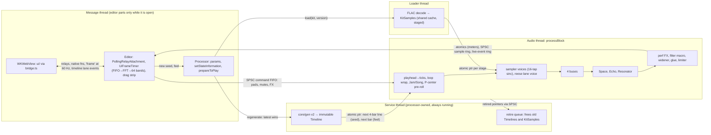

# S1: futuristic one-kit slice

*Approved 2026-10-29 with the recommended defaults. S1 replaces M1, M1b and M2 in `docs/ROADMAP.md`. Two reviews (feasibility and creative quality) were applied before approval; §11 lists what they changed.*

**Decisions.** You approved S1 on 2026-10-29 with the recommended defaults D1 to D5 in §10 ("lets build"), after listening to the prototype sounds. ADR 0005 records them and ADR 0006 the architecture. Your feedback on the prototypes added the "no mud" gate (§2.2, §5.2). The §10.2 inputs are still open.

Three things come back to you later, each as its own small approval:
1. The exact `CLAUDE.md` diff, line by line, in the S1.0 PR.
2. The vocal lines, picked from a candidate list at the start of S1c.
3. The parameter-ID freeze and the deletion of `SineVoices.{h,cpp}`, in S1g.

---

## 1. What you'll hear, play and see at the end of S1

You open Wubansia on your Mac: as an AU, VST3 or CLAP in your DAW, or as the Standalone app, which needs no DAW. It loads one kit, **"Alloy Signal" (FUT01)**: sci-fi 2-step at **134 BPM in F# minor (11A)**.

**What you hear.** A **core set of about 370 new sounds**, rendered natively at 48 kHz / 24-bit:
- a distorted kick on F#1, metallic FM snares and hats, alloy percussion
- a neuro reese that *talks* over a deep sub: the engine plays its glide, filter and vowel moves live from the MIDI
- alloy chord stabs, an airy pad, a chrome pluck
- vocal chops cut from sung phrases, and robot phrases sliced to the grid, so they stay in time at any tempo. Clean by default, R-rated behind a switch.
- glitch fills, risers and textures

The full-depth kit (more round robins, denser zones) is rendered only if the S1 sign-off says it's worth it.

**What it plays.**
- A fresh instance opens in **Jam mode on the Groove section**, with the Drop pad pulsing as the obvious next press.
- **Song** mode plays a full arrangement by the new generator:
  - 112–160 bars, with a form that changes with the seed
  - one hook per seed: it is planted early, withheld, then paid off in the drop
  - per-lane swing, with the kick and sub locked together
  - harmony and voicings that leave the old i–bVI–iv–v, m9-everywhere rut
- **New seed** writes a different track and swaps it in at the next 4-bar line, behind a one-beat glitch fill. The same seed always gives the same notes.

**How you play it.**
- **16 lit pads:** 8 sections and 8 performance effects (stutter 1/8 and 1/16, tape stop, filter sweep, space throw, echo throw, freeze, riser). The effects engage while held and release on the grid. Velocity sets their depth.
- **From MIDI** (§2.6):
  - notes 0–15 are the pads
  - drum notes play the kit's drums
  - C4–C6 plays the sung chops, snapped to the current chord
- **Four macros** (Filter, Space, Drive, Pump). Each moves several targets at once, shown as segments on the knob ring.
- **Three sends:** Space (with shimmer), Echo, and the **Alloy resonator**. The resonator retunes to the song's chords as they change, so hats and chops "sing" the harmony.

**What you see.**
- The panel looks like lit hardware. Pads and lane keys light exactly on the beat, because they are scheduled from the timeline.
- The WebGL stage follows the song's *structure*: energy, a countdown through builds, scene changes at section boundaries.
- A Studio↔Stage control turns the glow down when you want the clean, pro look.

**What you get out.** You can drag any lane's MIDI, or the whole song, into your DAW, with feel or quantized. You also get two blind listening rounds saying whether the new MIDI beats the old generator.

---

## 2. Scope

### 2.1 The kit

| | |
|---|---|
| ID / name | `FUT01`, **"Alloy Signal"**: a plain-words working name with no artist names. A WebSearch on 2026-10-29 found no exact title "Alloy Signal": only separate releases titled "Signal" or "Alloy". MusicBrainz returns 403 from this session, so it is checked again from a session that can reach it, before the S1c render. |
| Direction | A blend of **(a) sci-fi club × (b) future garage / 2-step**. (b) gives the 2-step chassis, the space, the pads and the chops. (a) gives the metallic FM drums, the neuro/reese bass, the glitch and the robot vocals. One set of inharmonic "alloy" ratios runs through both, so they read as one kit. |
| Shared with (c) and (d) | The distorted kick (d1), the supersaw stab (c3), the Karplus-Strong pluck (c4) and the Shepard riser (c5) are built only as far as FUT01 needs them. S1 does not build ahead for S2. |
| Tempo | Authored at 134 BPM and follows the host. Designed for 128–140. |
| Key | F# minor, **Camelot 11A**. `legacy/web-pack/core.js:21` maps F# minor to 11A with 3 sharps. |
| Kit DNA | The alloy ratios `1.0, 1.483, 1.932, 2.546, 3.011, 3.715, 4.468` (shared by perc, stabs, impacts and the resonator send), one Kokoro voice blend (e.g. `bf_emma` 0.6 / `af_nicole` 0.4) and one space seed `FUT01/space`. |

**Why this blend:**
1. 2-step lives on ghost notes, microtiming and syncopated bass. That makes it the hardest test of "MIDI that isn't written like AI"; four-on-the-floor would hide a weak generator.
2. It covers the widest DSP surface in one kit.
3. Future garage is defined by reverb throws, shimmer and chop delays, which shows off the effects.
4. Its UK garage roots make the comparison with the legacy generator like-for-like.

### 2.2 Sounds: a core set first

All files are 48 kHz / 24-bit FLAC, stored mono where L = R, named `FUT01_<Group>_<Sound>_v<layer>_rr<n>.flac`.

Sizes are estimates from rates measured on the prototypes during planning. Snare, clap, toms, blips, ride and pads were not prototyped.

| Lane | Core set (velocity layers × round robins) | Files | FLAC MB |
|---|---|---|---|
| Drums | Kick, F#1 (5×2); 2-step boom (4×1); metal snare (5×2); clap shard (4×2); rim (4×1); closed hat (5×3); open hat, choked by the closed (4×2); chrome ride (3×1); data ticks (3×2) | 68 | 6.1 |
| Perc | Alloy hit, F#5 (4×2), also used as the stab transient; glass toms F#3/A3/C#4 (3 layers); FM blips on 8 scale notes; impact cymbal ×2 | 27 | 2.4 |
| Bass | Neuro reese, E1–E3 every 3 semitones (9 zones × 2 layers, looped); deep sub, same zones (×1, looped, mono); growl shots from the resample chain (4 notes × 2 moves) | 35 | 10.2 |
| Stabs | Alloy stab, C3–C6 every 3 semitones (13 zones × 3 layers), **without** the baked metal layer; chord-shape stabs, m7(11) and quartal, on 6 roots, for Drop 2 planing | 51 | 6.9 |
| Pad | Air pad, C3–C6 every 3 semitones, 1 layer, looped | 13 | 12.6 |
| Lead | Chrome pluck (Karplus-Strong), C3–C7 every 3 semitones × 2 layers | 34 | 3.8 |
| Vox | 8 sung chops cut from 2 sung phrases × 9 zones (C4–C6); 4 robot vowels; robot phrases, 6 clean + 6 R-rated, sliced, wet + dry; shouts, 4 clean + 4 R-rated, wet + dry | 116 | 17.8 |
| FX | Risers (Shepard 8, noise 8, frequency-shifted 8 bars); downlifter; 2 alloy impacts; sub drop; 2 reverse swells; 8 glitch one-shots; 4 glitch fills; 4 laser zaps | 25 | 13.5 |
| Textures (FX lane) | Shimmer freeze bed, granular air bed, crackle bed, sub drone on F# | 4 | 8.3 |
| **Total** | about 570 s of audio; **about 206 MB in RAM as float32** | **373** | **≈ 82** |

**Full depth comes later.** The full kit is 1,145 files, 276 MB FLAC and 694 MB as float32: 3–4 round robins, 2-semitone zones, 12 + 12 phrases. It is rendered only after the S1h go, as S2's first item, and it needs M3's packed or streamed samples.

**Notes:**
- **Zones every 3 semitones** mean a repitch of at most ±1.5 semitones, through the engine's 16-tap sinc interpolator (§2.4).
- **Robot phrases are rendered on the 16th grid at 134 BPM.** Each syllable's onset sample and nominal step go into `index.json`. The sampler fires each slice at its own tick, REX-style, so a phrase stays on the grid at 128 or 140, and the generator can re-chop it ("sig-sig-signal").
- **Sung chops** come from 3–4 short sung phrases in F# minor. They render through the legacy phrase-singing path (`legacy/web-pack/audio/vocals3.py:315-556`: scoops, drifting vibrato, breaths), synthesized at 48 kHz (D4). They are cut at syllable boundaries, keeping the consonant onset and a breath tail. The isolated vowels survive only as a "robot" subset.
- **Stabs fire the alloy transient once per chord**, on the top voice, as a stab-transient sub-lane. Stacking a metal hit on every chord note would clang.
- **Risers are end-aligned.** At other tempos they start a little later. There is no riser synth in S1.
- **No mud (your feedback on the prototypes, 2026-10-29).** The first kick was muddy: its distortion rang in the 150–400 Hz band for 771 ms. Low-mid clean-up is now a QA gate (§5.2) for every kick, bass, tom and boom, measured on single hits and on a 2-step loop.
- **The kick's velocity curve must widen.** v1.0 against v0.4 measured −15.6 against −17.3 LUFS, too small a step for 5 layers.
- **The prototypes still fail QA in places.** Side energy below 120 Hz sits at −1.6 to −7.5 dB on 6 wide sounds, against a gate of −20 dB (measured during planning). DC fails on 4 (riser, stutter, vocoder, acid) and tails fail on 4 (alloy hit, both hats, stab). The fixes:
  - `mono_below(150)` in every pad, stab, texture and vocoder recipe, plus a ~100 Hz high-pass on pads, stabs and textures
  - the generator keeps pad and stab voicings at or above F#2 wherever the sub plays

**New sound-design tools** in `tools/sound/dsp48.py`, all numpy/scipy and already pinned:
1. a single-sideband **frequency shifter** (`scipy.signal.hilbert`): barber-pole risers, ticks and robot vocals, and ±5–50 Hz inharmonic detune on alloy hits
2. a **ring modulator** with alloy-ratio carriers
3. a 3-band **upward + downward compressor**, the "hyper-real" stage on the reese, the stabs and the snare
4. a **resample pass**: growl → reese → multiband → comb/formant, re-rendered twice

These add the processing layer that makes sci-fi sounds modern rather than textbook. The legacy audit listed ring modulation as missing.

### 2.3 MIDI: what the new generator writes

**Lanes.** One MIDI track per lane. Drum and perc notes are GM where an equivalent exists (36 kick, 38 snare, 39 clap, 42/46 hats, 51 ride, 49 impact), and every drum or perc note stays inside 35–59 (§2.6).

| Lane | Behaviour |
|---|---|
| Kick | 2-step grid: anchor on beat 1, high probability on step 10 or 7, never four-on-the-floor in 2-step sections. Anchored within ±2 ticks. On odd 16ths it takes the groove's base swing, so the skip kick sits in the pocket. |
| Snare/Clap | Backbeat on 2 and 4, ghosts one or two 16ths before. Clap 4–8 ticks behind the snare. |
| Hats | Swung off-16ths with probability 0.4–0.8; an open hat choked by the closed; occasional 24-step triplet fills. |
| Perc | Alloy hits and ticks as Euclidean E(5,16) and E(3,8) with rotation, plus a 3/16 polymeter reset every 8 bars. Glitch ratchets only on structural bars. |
| Bass | The sub follows the kick and sustains across the skipped beat. **Low-end lock:** any sub or reese onset on a kick step takes the kick's performed tick, with no fluctuation. Approach notes lead into chord changes. The reese joins in the drops: long notes on {1, b2, 5, b7}, slides (a legato flag the engine turns into glide), and CC1/CC74 "talk" shapes changed once per 2 bars. |
| Stabs | Voicings come from the texture palette below. Changes are pushed early. A transient sub-lane fires the alloy hit once per chord. Drop 2 planing uses the chord-shape samples. |
| Pad | Sustained harmony; an emergent tonic in the intro (withheld until later). |
| Lead | The hook, when it's a pluck riff, plays as a **RIFF** in the drops. **SENTENCE** or **PERIOD** forms are used in the break. |
| Vox | Sung chops answer the hook in the gaps it leaves. Robot phrases sit in the break and builds, sliced to the grid at feel 0 (on purpose), and re-chopped on structural bars. |
| FX + CC | Earned transitions (risers, impacts, dropout then impact); beds; CC91 throws on a phrase's last chop; CC74 filter arcs, which drive the bus filters. |

**Form: a grammar, not one table.**
- Sections start on 8-bar lines, which keeps the track DJ-friendly.
- Lengths are drawn from {8, 16, 24, 32} with weights per section kind. Totals run 112–160 bars, which is 3:21–4:47 at 134 BPM.
- Kinds: intro (DJ-tool or musical), groove, build, drop, break, drop 2, outro.
- Optional extras: an 8-bar switch-up inside drop 1, a 4+4 false drop, a second short break.
- **Drop 2 varies per seed:** a four-on-the-floor sci-fi switch, halftime, or 2-step with a new bass line.
- One seed might give Intro 16 / Groove 16 / Build 8 / Drop 32 / Break 16 / Build 8 / Drop 2 16 / Outro 16 (128 bars). That form is now one of many.

**The hook.**
- In the song-plan stage each seed gets one 1–2-bar hook, a chop riff or a pluck riff, written rhythm first.
- Its appearances are planned:
  - a filtered fragment in the intro (low CC74)
  - a bare or augmented statement over the pad in the break
  - the full hook in the drop
  - a register or ANSWER variant in Drop 2
- The other lanes' counter-motifs derive from its rhythm.

**Harmony** (a starting grammar, tuned by ear):
- Aeolian or Dorian, with Phrygian colour in the break.
- 2–3 chords over 2 or 4 bars; harmonic rhythm `[2,2]`, `[3,1]` or `[1,1,2]`; 40–60% of changes pushed by a 16th or an 8th.
- **Voicing texture palette** per section (2–5 voices, and recurring chords get re-voiced):

  | Section | Voicings |
  |---|---|
  | Intro | sus2, open fifths |
  | Groove | m7 or add9 triads with inversions |
  | Drops | dyads (root + 5th, m3 + b7), quartal 3-stacks, single-note stab riffs, planing |
  | Break | lush m9 / m11 / maj9, wide spread |

- An anti-cliché penalty, seeded with the legacy breakdown shape that 12 kits share and with the i–bVI–iv–v family.

**Variation by hypermeter tier.** The tiers are probabilistic, not clockwork:

| Tier | What happens |
|---|---|
| Every bar | Micro changes: ghosts, opens, velocity |
| 4-bar line | A turnaround, with p ≈ 0.5 |
| 8-bar line | One salient change with p ≈ 0.6–0.8; otherwise it is held to 16 bars or placed early, as a pre-change at bar 12 |
| Section boundary | A section change |

**Starting feel values** (to be tuned by ear). The swing delay on odd 16ths is `((sw − 500) · 240 + 500) / 1000` ticks: 540 gives 10 ticks (9.3 ms at 134 BPM), 630 gives 31 ticks (28.9 ms).

| Lane | Swing (permille) | Other |
|---|---|---|
| Hats | 580–630 | 1/f timing, SD 3–5 ticks |
| Ticks | 610–660 | |
| Ghost snares | 580 (the groove's base swing) | |
| Kick | 500 on even 16ths, 580 on odd 16ths | ±2 ticks |
| Bass | 540; onsets that coincide with the kick take the kick's tick | |
| Drop 2, four-on-the-floor row | hats 520–550, perc 540–580, kick 500 | |
| Pads, chops | — | P-center is measured per sample and applied by the engine, never written into the MIDI |

Each section kind gets its own feel row in `content/feels/sci2step.json`, so Drop 2 doesn't keep the 2-step hat swing.

**Export:**
- SMF type 1, 480 PPQ: one track per lane, plus CC74, CC1, CC91 and CC11
- tempo, an F# minor key signature and track names
- two versions of every file: "with feel" and "quantized"

### 2.4 Effects

All our own code on JUCE `dsp` building blocks. Bus grouping and macro curves live in `content/kits/FUT01.json`, as integers.

**Signal flow:**

| Stage | Contents |
|---|---|
| Reese lane (before its bus) | Mono legato voice with glide on the playback rate; a TPT SVF on CC74; a 2-formant band-pass pair on CC1 (the "talk") |
| Buses | Drums (kick, snare/clap, hats, perc); Bass; Music (stabs, pad, lead); Vox/FX |
| Per-bus inserts | Pump → SVF (macro plus the timeline's CC74) → drive or wavefolder (4× oversampled, Padé tanh) → crush → ensemble (Music only) → level and pan |
| Send A, **Space** | Own 8-line FDN with a shimmer amount (octave-up feedback). It ducks under the Vox bus, after the legacy "swell" (`legacy/web-pack/app.js:498-506`). Small rooms are baked into the samples (≤ 5%). |
| Send B, **Echo** | Tape ping-pong, dotted 8th by default, LP 2.6 kHz / HP 300 Hz in the feedback (legacy voicing, `app.js:225-229`) |
| Send C, **Alloy resonator** (the signature effect) | 5 comb resonators tuned to the current chord tones × the alloy ratios. They retune on the timeline's chord events, arriving early with pushed chords. Fed from Drums and Vox. |
| Master | Performance-FX capture → bipolar filter macro → widener (mono below ~150 Hz) → linked glue compressor → 64-sample lookahead limiter at −1 dBFS |

**Cost per effect** (µs per 128-sample block, Xeon VM, measured during planning):
- pump 0.9; filter macro (SVF, smoothed per sample) 2.8
- Space FDN with shimmer 17.4; Echo 5.2
- drive 6.9 (4× IIR oversampling + Padé tanh); crush 0.3; ensemble ~3.3
- glue 3.1; limiter 1.3
- resonator: a few µs, *not measured*

JUCE's Freeverb (`dsp::Reverb`) is rejected as generic, and convolution is left out (68.5–171.8 µs).

**Latency** is constant at about 68 samples at 48 kHz: the 64-sample lookahead plus 4.43 samples of oversampling. Every oversampler runs even at drive 0, so the figure never moves.

**Macros.** Each is one knob driving several targets, with curves stored as integer breakpoints. These are starting values, tuned in S1h.

| Macro | Targets |
|---|---|
| Filter | Master bipolar SVF (LP to the left, HP to the right); a resonance bump near both ends; Echo tone follows |
| Space | Space send on Music and Vox 0→60%; shimmer 0→40%; Echo send on Vox 0→30%; Music dry level 0→−3 dB |
| Drive | Drive on Drums, Bass and Music 0→70%; Drums crush 0→20%; Resonator send from Drums 0→30% |
| Pump | Pump depth on Bass, Music and Vox/FX 0→90%; release lengthens from 80 to 220 ms |

**Performance pads.** The effect pads share one 4 s capture ring, allocated in prepare.

| Pad | Press | Release | Starts on | Velocity sets |
|---|---|---|---|---|
| Stutter 1/8, Stutter 1/16 | Repeats from the capture ring | Stops at the next 1/16 | Next 1/16 | Pitch drift per repeat |
| Tape stop | Slows to zero | Spins back up (equal power) | Next 1/4 | Stop length, ½–2 beats |
| Filter sweep | Sweeps the filter macro | Returns to the knob over 1/4 | Next 1/4 | Sweep range |
| Freeze | 1/32 grain loop, crossfaded, fed into Space | Releases at the next 1/16 | Next 1/16 | Space level |
| Space throw, Echo throw | Latches the send to 100% for 2 beats, ducks the dry signal, lets the tail ring | — | Next 1/4 | Throw level |
| Riser | Plays the sampled riser so it ends on the next 8-bar line | — | — | Level |
| Section pads | Queue the section | — | Next 1 or 4 bars (a setting) | — |

**Pad lights:**
- The current section is lit solid.
- A queued section blinks on the beat while the LCD counts down the bars.
- An active effect pulses at its rate.
- Lane keys, not pads, flash on hits.

**CPU budget**, on one core at 48 kHz / 128 samples:

| Part | Budget | Status |
|---|---|---|
| Sampler (64 voices × stereo × 16-tap sinc, ≈ 262k multiply-adds per block) | ≤ 6% | Estimate, not measured |
| Effects | ≤ 6% | The chain is estimated at 3.5–5%, but on the Xeon VM |
| Everything else | ≤ 3% | |
| **Whole plugin** | **≤ 15%** | Benchmarked on macos-15 arm64 in S1d (sampler) and S1e (effects) |

**Sampler interpolation.** A polyphase windowed sinc: 16 taps, 256 phases, with the table built in prepare. A voice at ratio 1 just copies.

Linear and Hermite interpolation reach only about −31 dB of alias on a bright source, against −62 to −66 dB for the sinc (measured during planning, re-run 2026-10-29). Every voice resamples at 44.1, 88.2 and 96 kHz hosts.

### 2.5 UI

The editor is a fixed **1120 × 700 pt**, which fits the smallest default 13-inch MacBook Air workspace (1280 × 832) with room for the host's window header. Resizing waits for M4. Dark theme only.

1. **Play**, the one screen:
   - **LCD header**, in the Doto dot-matrix face: kit, BPM, F#m · 11A, bar:beat, current section, and seed digits that roll on New
   - **transport:** play, stop and tempo in Standalone; "Sync" in a DAW
   - **seed block:** previous, seed number, New, and the **Feel** knob (0–100%, the generator's `amount`)
   - **section strip** drawn from the current timeline, so it changes with each seed (after legacy `drawSong`, `app.js:1472`)
   - **4×4 pads** (§2.4) on MIDI notes 0–15 and on computer keys 1-4 / Q-R / A-F / Z-V (legacy `hitPad`, `app.js:1743`)
   - **10 lane keys** that mute their lane and flash on hits
   - **4 macro knobs**, with their targets drawn as segments on the ring
   - the **WebGL2 stage** behind the panel
2. **Mix drawer:**
   - 4 bus faders with meters and mutes
   - the returns: Space (size, decay, shimmer), Echo (time, feedback, tone), Resonator (amount, decay, brightness)
   - a master meter with gain reduction, display only

   Per-bus pump, filter, drive and crush are reached through the macros. Per-bus knobs wait for M4.
3. **Settings drawer:**
   - Glow: Studio↔Stage
   - reduced motion
   - **explicit vocals** (off = clean)
   - section quantize: 1 or 4 bars
   - pad base note: 0, or 36 for MPC mode
   - about and licenses
4. **Drag strip:** native JUCE, about 32 px, below the WebView. 10 lane chips plus "Song", with a feel/quantized toggle. Its colours come from the same `ui/src/theme/tokens.json` that builds the CSS (compiled into a C++ header at build time). The chips move into the page if the drag spike works (§3.6).

**The stage:**
- a half-resolution bloom and a 64-band spectrum layer
- the energy curve drives bloom gain and particle density
- build progress drives a converging visual with a bar countdown to the drop
- the chord root shifts the hue within the single accent family
- a section change triggers a scene transition
- each lane gets its own glyph: a ring pulse for the kick, sparks for the hats, a ribbon for the chops
- theme: "alloy and haze"

**Look rules:**
- 8 px grid, one accent hue, 120–200 ms easing
- glow layers are pre-blurred; only `opacity` and `transform` animate, never `box-shadow` or `filter`
- fonts: Space Grotesk (UI), JetBrains Mono (numbers), Doto (LCD), all OFL-1.1

**The first minute:**
- Standalone and a fresh plugin instance open in Jam mode on Groove.
- Loading is staged: drums, perc and bass first (130 files, about 19 MB of FLAC), then the rest.
- New seed changes at the next 4-bar line, behind a 1-beat fill.
- Targets: sound within 2 s of opening (Standalone, warm cache), and the drop within 15 s of the first press.

### 2.6 MIDI in and out

| Notes in | What they do |
|---|---|
| 0–15 | The 16 pads. **MPC mode** in Settings moves them to 36–51, for 4×4 controllers, and turns off drum play. |
| 35–59 | Play the kit's drums and perc, on the same notes the export uses |
| 60–84 | Play the sung chops, snapped to the current chord's scale |

Exported MIDI uses only 35–59 for drums and perc. Dragging it back onto a Wubansia track therefore plays drums, never tape stops. The map is written in `docs/midi-map.md`. Note numbers are used because DAWs disagree on octave names.

### 2.7 Deliberately out of scope, and what to cut if S1 runs long

**Out of scope:**
- **Content:**
  - full-depth FUT01 (S2's first item); kits for (c) and (d); the acid engine voice and every synth voice (S1 is sampler only)
  - the 43 legacy kits and their genres in the plugin; kit switching
  - per-lane alternative sound characters (the S1a A/B picks one); the formant lead (no lane plays it)
  - time-stretch: sliced phrases and end-aligned risers avoid it
- **Engine:**
  - multi-out, MIDI out, the MIDI FX variant
  - convolution, CloudSeed, chowdsp (its DSP modules are GPLv3)
  - a riser synth; live ring or frequency-shift effects
  - packed 24-bit samples (the core set fits in ~206 MB as float32)
  - the RTSan job, which stays in M3 (ADR 0001 D5)
- **Generator controls:** lane locks, "mutate this bar", and the density, syncopation, energy and fill knobs (M5)
- **Workflow:** presets, the arrangement editor, stem export, audio drag-out
- **UI:** light theme, resizing, per-bus knobs
- **Platforms and release:** Windows, AAX, iPad, signing and notarization (ad-hoc signatures only, ADR 0004)

**Cut order if S1 runs long:**
1. staged loading
2. the chop keyboard and drum play from MIDI
3. stage layers beyond spectrum, energy and countdown
4. the Freeze pad
5. the Mix drawer down to faders only

The resonator, the hook and the form grammar stay: they are what makes this slice different.

---

## 3. Architecture: A, plugin-native, built "render first"

**Choice.** Everything that ships is C++ from the start. Each goal gets an early check through files, before the plugin can play:
- `.mid` files from the generator
- 48/24 sample renders
- WAV renders through the real C++ sampler and effects
- the UI in Safari on a mocked bridge (the same WebKit engine as WKWebView)

**Rejected:**
- **B, a WebAudio prototype first.** You would sign off effects that never ship, and the generator would be written twice.
- **C, WebAssembly.** It puts a second host in front of the first listen. It stays possible after v1, because `core/` stays free of JUCE and libm.

### 3.1 Components and threads



### 3.2 Data flow

1. **The services belong to the processor, not the editor.** The processor's constructor creates a service thread. It runs generator jobs ("latest wins"), drains the retire FIFO every 50 ms and starts kit loads. `setStateInformation` and `prepareToPlay` queue work there, so a project that reopens with its editor closed (and Linux CI, which has only a placeholder editor) still loads, plays and frees old objects off the audio thread.
2. **New seed or Feel.** The generator builds a Timeline in under 50 ms: performed events, the quantized score, sections, CC curves, precomputed fills and slice events.
   - A new seed is adopted at the next 4-bar line and enters through a 1-beat glitch fill taken from the new timeline.
   - A Feel change is adopted at the next bar.
   - The old Timeline goes back through the retire FIFO.
3. **Kit load.** `juce_audio_formats` decodes the FLAC (FLAC stays on, ADR 0001) into a **process-wide, reference-counted cache** keyed by (kit ID, content version). Instances of the same plugin binary share it, so duplicating a track doesn't double the RAM.
   - Loading is staged: drums, perc and bass first, then the rest. Each stage is published as a new immutable `KitSamples`. Lanes that aren't loaded yet stay silent, and the UI shows progress.
   - **Offline bounce (D5):** when the host reports `isNonRealtime()`, `processBlock` waits on an atomic "ready" flag (bounded at 30 s) instead of rendering silence. It never waits in real time.
4. **Play.**
   - The host PPQ maps to song ticks (120 per 16th), and the block is split at loop wraps.
   - **Song** mode follows host bar 1. **Jam** mode loops the chosen section and switches on the next 1 or 4 bars.
   - Standalone has an internal transport (128–140 BPM, default 134).
   - Voices start early by their sample's measured P-center (`pcenter_samples` in `index.json`, clamped to one 16th). The timeline is known ahead of time, so this adds no latency.
5. **Meters and lights.**
   - Per-bus peak and RMS go into `std::atomic<float>` slots, read with `exchange`. The master's mono samples go into an `AbstractFifo` ring of 8,192 floats.
   - A 256-slot ring carries only *live* events (pads, MIDI in).
   - The editor's timer runs at 60 Hz while playing, 10 Hz idle and off when hidden. It runs a 2048-point FFT and sends one `frame` event: `{t, ppq, bpm, playing, bands[64], meters[8], gr, live[]}`.
   - **Lane flashes come from the timeline:** JS fetches the lane events once per timeline swap (compact binary from the resource provider) and schedules them against a playhead extrapolated from `ppq` and `bpm`. The offset is our reported latency, plus the device output latency in Standalone. A plugin can't read the DAW's output latency, so the DAW check verifies the timing.
6. **Parameters.** `PollingRelayAttachment` maps the relay events (`juce_WebControlRelays.cpp:107-120`):
   - `sliderDragStarted` → `beginChangeGesture`
   - `valueChanged` → `setValueNotifyingHost`
   - `sliderDragEnded` → `endChangeGesture`

   The timer pushes host values back with `relay.setValue`, except while a gesture is open. No parameter listener is ever registered, which closes ADR 0001 D5 items 3–4. Changes to state-only data (seed, Feel, mutes, mix) call `updateHostDisplay(ChangeDetails().withNonParameterStateChanged(true))` (`juce_audio_processors_headless/processors/juce_AudioProcessorListener.h:124`), so hosts mark the project dirty.

### 3.3 Where code lives

| Path | S1 contents | JUCE? |
|---|---|---|
| `core/gen/` | `rng.h` (counter RNG), `json.*` (strict reader for **integers only**), `style`, `form`, `hook`, `harmony`, `rhythm`, `motif`, `fills`, `feel` | No |
| `core/model/`, `core/midi/`, `core/metrics/` | Event, Score, Timeline, Section; the SMF writer; the metrics in §5.1 | No |
| `core/tests/` | Catch2; `snapshots/gen.sha256`; `legacy_expected.json`; fixture SMFs | No |
| `engine/kit/` | `KitSamples`, the shared cache, the staged loader | Loader only |
| `engine/sampler/`, `engine/sched/` | Sinc interpolator, zones, layers, RR, loops with a per-note phase offset, choke, the reese lane voice, slices, P-center; ticks↔samples, loop wrap, Jam/Song | No |
| `engine/fx/`, `engine/perf/` | The effects in §2.4; the capture ring, throws, freeze | `juce_dsp` (Oversampling, DelayLine, SVF) |
| `engine/render/`, `engine/tests/` | Offline renderer; RT, FX, render and service tests; a synthetic test kit; Linux render hashes | |
| `cli/` | `groovecore` with `gen`, `metrics` and `render` | `juce_core`, `juce_audio_formats` |
| `plugin/source/` | Processor (engine, service thread, host sync, parameters, state v2, MIDI map), Editor (WebView, resource provider, native functions, `PollingRelayAttachment`, `UiFrameTimer`, `DragStrip`), Standalone transport | Yes |
| `ui/` | Vite + TS. `src/bridge.ts` (+ `juce.ts`, `mock.ts`), `screens/play`, `drawers/{mix,settings}`, `controls/{knob,pad,fader}`, `stage/` (raw WebGL2), `theme/tokens.json`, `tests/*.spec.ts` | Interop from the JUCE submodule |
| `tools/sound/` | `dsp48.py`, `recipes.py`, `kits/fut01.py`, `render.py`, `qa.py`, `sheet.py`, `tests/` (stdlib `unittest`) | — |
| `tools/` | `export_golden.js`, `legacy_audit/`, `fetch_content.py`, `content/pack.py`, `listening/blind.py` (+ player) and `legacy_map.json` | — |
| `content/` | `kits/FUT01.json` + `schema.json` (C++-read, integers and strings only), `kits/FUT01.dna.json` (Python only), `styles/sci2step.json`, `feels/sci2step.json` (+ schemas), `lyrics/FUT01.json`, `index.json`, `golden/legacy-v21.sha256` | — |
| `docs/` | ADRs 0005–0019, `listening.md`, `midi-map.md` | — |

**Integer-only JSON for C++.** Units go in the field names (`_pm`, `_ticks`, `_mdb`, `_hz`, `_p16`). One strict reader then serves `core/` and `engine/`, with no locale or float issues and **no JSON library**.

### 3.4 Build switches

- **WebView on Apple only:** `JUCE_WEB_BROWSER=1` inside `if(APPLE)`. Today it is 0 everywhere (`plugin/CMakeLists.txt:30`).
  - Linux is CI-only: it keeps the WebView off and shows a native placeholder editor.
  - This avoids `libwebkit2gtk`, which the Linux job leaves out on purpose (`.github/workflows/ci.yml:97-98`).
- **New JUCE modules:** link `juce_dsp` and `juce_gui_extra`. Both are already in the pinned submodule.
- **UI bundle.** `npm --prefix ui ci && npm --prefix ui run build` runs as its own step: cached in CI, with a lockfile, and listed in CLAUDE.md's commands.
  - CMake embeds `ui/dist` with `juce_add_binary_data`. On Apple it stops with a clear message if the bundle is missing, so configuring still downloads nothing (ADR 0001, amended in ADR 0017).
  - Debug builds can point at `http://localhost:5173` for hot reload inside the DAW.
- **Node:** one exact LTS version in a root `.nvmrc`, used by the UI build and by `golden_check`. This container has v22.22.0.
- **CI paths:** remove `legacy/**` from `paths-ignore` (`ci.yml:43,47`), so a change to `core.js` runs `golden_check`.

### 3.5 Determinism of audio renders (ADR 0015, decided now)

- **The generator stays bit-identical everywhere.** It is integer-only (§4.2).
- **Audio renders:**
  - exact hashes on Linux CI, a single pinned image
  - on macOS, the render is compared with the Linux render by tolerance (null residual, ±0.1 LU, per-band spectrum)
  - on macOS, rendering twice in one run and every block-size variant must still be byte-identical
- **Why not bit-identical across platforms.** `juce_dsp` builds coefficients with libm: `StateVariableTPTFilter::update` calls `std::tan` (`juce_StateVariableTPTFilter.cpp:134`), and the oversampler's half-band design uses `std::pow`, `tan`, `log` and `sin` (`juce_Oversampling.cpp:283,287` → `juce_FilterDesign.cpp:630-672`). On Apple, JUCE also routes vector helpers to Accelerate: `JUCE_USE_VDSP_FRAMEWORK` defaults to 1 (`juce_audio_basics.cpp:51-52`), and `addWithMultiply` becomes `vDSP_vsma` (`juce_FloatVectorOperations.cpp:738-741`). That path is used by `AudioBuffer::addFrom` with a gain (`juce_AudioSampleBuffer.h:836,878`) and by `AudioBlock` (`juce_AudioBlock.h:819`). Matching Linux bit for bit would mean rewriting those blocks.
- **Rule:** our mixing and gain code uses plain scalar loops. A grep test bans `FloatVectorOperations` and the `AudioBuffer`/`AudioBlock` gain and add helpers in `engine/`, so the block-size check holds exactly on macOS too. The FFT is for meters only and is never hashed.

### 3.6 MIDI drag-out (spike in S1f)

- **No pure HTML5 route:** Safari doesn't support the `DownloadURL` drag type ([web.dev Box case study](https://web.dev/case-studies/box-dnd-download)).
- **The route through JUCE:**
  1. JS calls the native `startMidiDrag(lane)`.
  2. C++ writes the file to `~/Library/Caches/…/drag/`.
  3. C++ calls `performExternalDragDropOfFiles({file}, false, &webView, onDone)`, passing the source view explicitly (`juce_Windowing_mac.mm:52-63`).
- **Why a spike:** the call depends on `currentEvent` timing (`:192-238`).
- **Fallback:** the native drag strip. A JUCE overlay can't sit above the WebView, which is a native `NSViewComponent`.
- **One file per drag.** Reports say multi-file drags drop only the first file on macOS.

---

## 4. The new generator (`core/gen`, "v2")

### 4.1 Design

**Pipeline**, with feel always last:
1. song plan: form grammar, energy curve, hook
2. harmony: progression grammar, voicing palette
3. rhythm skeletons per lane and section
4. pitches: hook realization, RIFF / SENTENCE / PERIOD, bass
5. phrase variation
6. fills and transitions
7. feel
8. metrics

**What each stage does:**
- **Harmony:**
  - modes, loop lengths of 1/2/4/8 bars, harmonic rhythm in half-bars, pushed changes
  - tonic strategy (present, fragile, emergent or absent; Spicer 2017)
  - pedals; chord-memory planing, tagged so the in-key check accepts it
  - the anti-cliché memory, and no repeated shape inside a song unless the form says "return"
  - voicings chosen by voice-leading cost, a planned top-line arc and the section's texture palette
- **Rhythm:**
  - 2-bar probability grids with style anchors
  - a syncopation score (LHL) kept inside a style band per energy level (inverted U, Witek et al. 2014)
  - displacement, Euclidean, polymeter and ratchet operators
  - a fixed number of attempts, then a deterministic "best so far"
- **Hook and motifs:**
  - one hook per seed, rhythm first, with scheduled appearances (§2.3)
  - pitches stored as chord-relative degrees, so motifs re-harmonize when the chord changes
  - **RIFF** (the default for the drop pluck): a 1–2-bar rhythm cell, 3–5 pitch classes, 4th/5th/octave leaps allowed, chord-following re-pitch, and one note or one step mutated every 4–8 bars
  - **SENTENCE / PERIOD** for the break lead and the chop answers: about 65% steps, one planned and resolved non-chord tone per phrase, leaps that reverse toward the median of the range (von Hippel & Huron 2000)
  - development operators REPEAT, VARY, SEQUENCE, ANSWER, FRAGMENT, AUGMENT and CADENCE, each changing one thing
  - call and response through a half-bar occupancy mask (generalizing legacy `counterCall`)
- **Earned fills:**
  - importance tiers (end of 4, 8, 16 bars, end of section) and a fatigue term
  - never a repeat of either of the last two fills; dropouts count as fills
  - set-up (thin the bar before) and pay-off (an impact only after a medium or larger fill)
- **Feel:**
  - per-lane swing, a 2-bar offset map and velocity map per lane, and a row per section kind
  - **1/f (Voss–McCartney) fluctuation, never i.i.d. jitter**. Hennig et al. 2011 found listeners prefer long-range-correlated timing ([PMC3202537](https://pmc.ncbi.nlm.nih.gov/articles/PMC3202537)).
  - anchors clamped to ±2 ticks, because exact grids rated highest for simple patterns (Frühauf, Kopiez & Platz 2013)
  - the low-end lock
  - a dip before accents; per-voice chord velocity (top voice +4 to +8)
  - articulation drawn from a distribution
  - `amount` is the Feel knob
- **Score and performance are kept separate**, so tests check both and the export offers "with feel" or "quantized".
- **Style and feel are hand-authored** JSON (`content/styles/sci2step.json`, `content/feels/sci2step.json`). No third-party MIDI is used. The Groove MIDI Dataset is CC BY 4.0, but it is acoustic-kit drumming, and shipping its sequences would make the grooves not ours.

### 4.2 How determinism is kept

- **No `float` or `double` in any decision or timing.** Ticks, permille, `p16` probabilities in [0, 65536], integer velocities and offsets. The content JSON is integer-only too.
- **Counter-based RNG.** Each draw is a pure function of (seed, purpose, lane, bar, step), so adding a lane or retrying a bar never shifts another lane's numbers. This also makes M5's lane lock and "mutate this bar" nearly free.
  ```cpp
  constexpr uint64_t mix64(uint64_t z) { z += 0x9E3779B97F4A7C15ull; z = (z ^ (z >> 30)) * 0xBF58476D1CE4E5B9ull;
                                         z = (z ^ (z >> 27)) * 0x94D049BB133111EBull; return z ^ (z >> 31); }
  struct Key { uint64_t h; constexpr Key with(uint64_t x) const { return {mix64(h ^ x)}; } };
  inline uint32_t below(Key k, uint32_t n) { return uint32_t((uint64_t(uint32_t(mix64(k.h) >> 32)) * n) >> 32); } // Lemire
  // root.with(tag("bass")).with(bar).with(step)
  ```
- **Library and ordering rules:**
  - never `std::*_distribution` (libc++ and libstdc++ differ)
  - never iterate unordered containers
  - `std::stable_sort` with a total order (tick, lane, note)
  - `floorDiv` for negative offsets
  - every loop has a fixed attempt cap
- **Proof.** `core/tests/snapshots/gen.sha256` holds the SMF SHA-256 of 16 seeds × {feel, quantized}. It must match on Linux x86_64 and on macOS arm64, through a dispatched macOS run at the end of S1b2. It is also checked on x86_64 under Rosetta, if the runner has it (to be checked).
  - These are **generator snapshots, not goldens**. Each regeneration goes in its own commit until the S1h sign-off, and they are **frozen in S1h**. After that, any change needs its own commit and a reason, plus an ADR note if it is musical.
- **Saved projects keep their notes.** State v2 stores the seed, `gen_version` and the compressed score. Reopening after the generator improves gives the same notes; "regenerate with the current generator" is an explicit action.

### 4.3 Legacy `core.js` and the M2 port: decision D2

| Option | What happens | Cost / value |
|---|---|---|
| **A (recommended): drop the port** | `legacy/web-pack/core.js` is frozen. `tools/export_golden.js` exports its 516 MIDI files (12 per kit, original key and BPM) into `build/golden/`. `content/golden/legacy-v21.sha256` (516 lines, with the pinned Node version in its header) proves the baseline never drifts. `golden_check` regenerates the files, checks the manifest and runs the metrics, **asserting that the legacy files fail the gating bands**. The same files feed listening condition L. | Saves all of M2 (sized M–L). Commits no MIDI: 8.4 MB, 1.8 MB gzipped, measured. The 43 old kits can't play in the plugin. |
| B: port it after S1 as a "Classic" mode | M2 as planned | M–L of work on a generator you said sounds AI-written |
| C: escape hatch, if the classics are ever wanted | Embed `core.js` through QuickJS (ROADMAP §2's fallback) | Cheaper than a byte-exact port; no work now |

**Node is pinned** because `core.js` writes `Math.sin` and `Math.pow` results into CC and pitch-bend bytes (`core.js:2415, 2759, 2784, 2935, 2957`), so a V8 change could alter them. With A, M1's "kits to JSON", "transposed goldens" and "split the old sprites" are dropped. The content bundle and fetch script move to S1c.

---

## 5. Tests first

### 5.1 Generator metrics (`core/metrics`, Catch2)

**Setup:**
- 64 seeds per test. The metrics read SMF bytes, so the same code scores the legacy baseline.
- **The test of the test.** In S1b1, one legacy audit is ported, with written metric definitions, to `tools/legacy_audit/` (pinned Node). Its output on the 516-file baseline is committed as `core/tests/legacy_expected.json`, and it is treated like the golden manifest: never regenerated to make a test pass.
  - The C++ metrics must match it exactly, or within a tolerance stated per metric.
  - Small hand-built fixture SMFs with known answers test each metric without the legacy files.
  - The two scratch audits disagree on a few figures (for example, the hat accent period is 76.5% or 81% depending on the definition), so the port fixes one definition per metric.
- **The bands are two-sided,** so both "literal copy" and "aimless drift" fail. Drift is the machine-learning failure (Wu & Yang 2020, [arXiv:2008.01307](https://arxiv.org/abs/2008.01307)).
- **Only 10 metrics gate.** They are the ones that clearly separate legacy from new. The rest are reported, because tuning to many metrics is Goodhart's law.

**Gating metrics** (the new generator must pass):

| # | Metric | Band | Legacy (audit) |
|---|---|---|---|
| G1 | Progression-shape diversity | Distinct ≥ 50% of seeds; top shape ≤ 10% | 12 of 43 kits share one breakdown shape (28%) |
| G2 | Harmonic rhythm | "4 × 1-bar slots" ≤ 30% of seeds; ≥ 4 patterns | 43 of 43 |
| G3 | One-bar repetition in 4-bar parts | Drum lanes ≤ 40% (four-on-the-floor kick exempt); bass ≤ 30% | 82% / 70% |
| G4 | Macro changes on phrase-start or phrase-end bars | ≥ 50% (random = 25%) | 30% / 29% / 33% |
| G5 | Velocity resolution per 8 bars | Hats, perc, ghosts ≥ 10 values with SD 6–22; bass and lead ≥ 6 values with SD ≥ 8 | Drums on ≤ 9 levels (`velDigit`, `core.js:1368`); 3 per melodic lane |
| G6 | Chord stacks with ≥ 2 velocities | ≥ 70%; pad spread 0–4 ticks | 0 of 1,018 |
| G7 | Microtiming on feel lanes | Residual SD 1.5–6 ticks; lag-1 autocorrelation ≥ 0.2; DFA α 0.65–1.1 | Lag-1 ≈ 0 (white noise) |
| G8 | Per-lane swing | ≥ 3 distinct swings among non-anchor lanes | One value per kit |
| G9 | Fills | 100% of section boundaries carry a gesture; no fill position > 60%; ≥ 70% distinct per song | 100% on bar 8 of 8 |
| G10 | Form diversity | ≥ 8 distinct form shapes in 64 seeds; top form ≤ 25%; intervals between salient changes take ≥ 2 values | 7 forms for 43 kits, none seed-dependent |

**Reported, not gating:**
- R4 repetition (kick 0.70–0.95, chords 0.50–0.85, bass 0.40–0.80, lead 0.30–0.70)
- loop tiling
- hat accent period ≤ 4 steps in ≤ 40% of bars (legacy 76–81%)
- gate-rule share ≤ 50%
- chord-tone profile; breath and complementarity
- **template-aware** lead shape: RIFF step ratio 0.2–0.6 and bar 1 = bar 3 rhythm 0.6–0.9; SENTENCE step ratio 0.5–0.8 and bar 1 = bar 3 ≤ 0.6 (legacy 97.7%)
- voicing texture: ≥ 3 types per song, 4+-note extended voicings on ≤ 60% of onsets, ≥ 25% of recurring chords re-voiced
- odd cycles; cross-seed duplicate 2-bar motifs ≤ 3%; syncopation band

**Invariants** (unit tests that must always pass):
- same seed → same bytes; changing one lane leaves the other lanes' bytes alone
- 128 bars generate in **under 50 ms** (Release, Linux CI)
- every note is in key unless tagged `borrowed` or `planed`
- rolls and risers sit on the swung grid (legacy: 50% of riser notes straight)
- **kick–bass coincident onsets within 2 ticks: 100%**
- the hook appears in ≥ 3 sections, at least once before the first drop, and in ≥ 50% of drop bars
- every section starts on an 8-bar line; anchors stay within ±2 ticks

### 5.2 Sample QA (`tools/sound/qa.py`, `unittest`, no pytest)

Fixtures reproduce the six defects the prototypes hit (truncated tail, click at the start, anti-correlated low end, DC from drive twice, anti-correlated freeze bed), and QA must flag each one.

| Check | Pass |
|---|---|
| Format | 48 kHz PCM_24 FLAC; mono where L = R |
| True peak (4×) | ≤ −1.0 dBTP |
| DC (5 Hz zero-phase low-pass, max) | ≤ −60 dBFS |
| First sample | ≤ −80 dBFS (0.25 ms fade-in) |
| One-shot tails | Last 10 ms ≤ −70 dBFS (render long, trim at −90 dB relative to peak) |
| Splices, seams, slice edges | ≤ +12 dB HF burst at logged splices; loop seam ≤ +3 dB |
| Aliasing on tonal sustains | ≤ −60 dB unless `deliberate_alias` |
| Stereo | Correlation ≥ 0.2; side below 120 Hz ≤ −20 dB |
| Tuning | ±3 cents (kicks ±10) |
| **Mud (your rule: no muddy low end)** | Kicks, basses, toms and the 2-step boom: the 150–400 Hz band falls 30 dB within 120 ms; after the first 80 ms it stays ≥ 20 dB under the 30–120 Hz band; its share of the sound ≤ −12 dB. The 400 Hz–1 kHz band falls 30 dB within 150 ms. Everything else with low end (pads, stabs, textures, chops): high-passed so nothing below ~100 Hz competes with the kick and sub. Also checked on a 2-bar 2-step loop, because mud builds up between hits. Prototype kick: 771 ms and −2.4 dB, so it fails; this is what you heard. |
| Velocity and RR | Loudness rises ≥ 1.5 dB per layer and the centroid rises; RR within ±0.5 dB |
| Loudness by category | Beds −20 LUFS-I ±1; risers −14 ±2 with a rising shape; vocals wet −16 / dry −18 ±1; one gain per instrument (no per-file normalizing) |
| Reproducibility | Same SHA-256 when rendered twice in the pinned Linux environment |
| Content | Artist-name denylist on names and strings; Whisper transcript matches the script **on dry vocal files only** (wet robot versions fail ASR); slur denylist; `explicit` and `hf_synthetic` flags set |

### 5.3 Engine, effects, real time (`engine/tests`)

| Test | Pass |
|---|---|
| Allocation counter (extends `plugin/tests/RealtimeTests.cpp`): full chain, 64 voices, perf FX on, during timeline and kit swaps | 0 allocations and frees |
| Engine-only lock counter (Linux `pthread_mutex_lock` interposition) | 0 |
| TSan stress: 1,000 timeline swaps plus kit swaps while audio runs | No reports |
| **No editor:** 1,000 timeline swaps and 20 kit swaps without ever creating an editor | Retire queue empty afterwards; no memory growth |
| Block-size independence: 1, 17, 128, 512, 2048 and random sizes | Identical bytes on Linux **and** macOS (control rate on fixed 32-sample boundaries from the song start) |
| Render determinism | Linux: exact per-render hash. macOS: identical across runs; within tolerance of Linux (§3.5) |
| Grep test | No `FloatVectorOperations`, `AudioBuffer::addFrom`/`applyGain` or `AudioBlock` arithmetic in `engine/` |
| Interpolator | Alias ≤ −60 dB at ±1.5 semitones and at 44.1, 88.2 and 96 kHz hosts; in tune ±1 cent |
| Reese lane voice | A CC1 sweep moves the spectral centroid of a held note; a slide gives a continuous pitch trace |
| Host sync: loop wrap mid-block, tempo change, jump back, start mid-bar, stop/start, seed swap at the 4-bar line | Events at exact sample offsets; no stuck notes |
| Offline bounce (D5) | With `isNonRealtime()`, the first block waits for the kit and renders it; in real time it never waits |
| Effects | FDN T60 within ±10%; limiter sample peak ≤ −1 dBFS; pump gain reduction at kick ticks; drive alias ≤ −60 dB at a 5 kHz input; reported latency = actual; resonator tuned to the chord tones ±5 cents; stutter and freeze splices pass the §5.2 check; bypass is a click-free crossfade |
| CPU (Catch2 `BENCHMARK` on macos-15 arm64) | Sampler ≤ 6%, effects ≤ 6%, plugin ≤ 15% (reported; gate at 2× for runner noise) |
| CI | A synthetic 8-sound test kit generated in code, so CI never downloads content |

RTSan stays an M3 deliverable (ADR 0001 D5). CI pins clang 18 (ADR 0004), and adding clang 20 belongs with M3's host matrix.

### 5.4 UI (Playwright on the mocked bridge, WebKit project)

- Play and both drawers render with no console errors and no requests outside the page's origin.
- A knob drag sends `dragStarted`, at most one value per animation frame, then `dragEnded`. Shift gives fine steps, double-click resets and the arrow keys work (the legacy model, `legacy/web-pack/ui/lab.js:14-75`).
- Pads respond to the mouse and to the 16 computer keys. Section pads show solid, blinking and countdown states; FX pads pulse while active.
- **A lane key flashes within one frame of the mocked playhead's event time.**
- The animation loop stops when `document.hidden`; `prefers-reduced-motion` turns the stage off; Glow scales the bloom.
- Visual snapshots of Play and both drawers.
- Bundle budget: JS + CSS ≤ 150 KB gzipped (the JUCE interop library is 3.3 KB); fonts ≤ 250 KB.
- **Bridge contract:** one JSON schema of message shapes, checked by Playwright and by a C++ test.
- Caveat: Playwright's WebKit on Linux is not WKWebView inside a DAW. That part is checked by you in S1f and S1g.

### 5.5 Plugin

- pluginval at strictness 10 on the VST3 and the AU; `auval -strict`; clap-validator report-only (ADR 0004).
- `ParameterTests`: the frozen list, `{master_gain}` plus the 8 S1 IDs once you approve the freeze in S1g, with ranges, defaults and **version hint 2**.
- `StateTests`:
  - the M0 bytes still restore −12.5 dB
  - **"M0 saves exactly the v1 fixture" (`plugin/tests/StateTests.cpp:113`) is retired and replaced by "the v1 fixture loads and migrates to v2"** (ADR 0019)
  - a v2 round trip covers seed, `gen_version`, score, Feel, mode, mutes, mix, the explicit flag, pad base note, kit ID and content version
  - a newer version survives a save
  - state-only changes set the host's dirty flag
- `RealtimeTests` with the engine and the test kit.
- The editor opens and closes 20 times: the WebView on macOS, the native placeholder on Linux.
- `IdentityTests` unchanged (stereo out, MIDI in).

### 5.6 Listening protocol (new `docs/listening.md`)

- **The blind player.** `tools/listening/blind.py` writes the excerpts under random IDs plus a self-contained `player.html`. The player shuffles, plays, shows the key file's SHA-256 and saves your ratings as a JSON file you send back. It ships in the prerelease zip, because the audio is too big for a web page. Claude unblinds the results and writes `listening.md`.
- **Stimuli:**
  - **L:** legacy UKG kits, rendered at F#m / 134 through the same engine and core kit (`legacy_map.json` maps their lanes)
  - **N:** the new generator
  - **N0:** the new generator with feel off
  - loudness-matched to −14 LUFS ±0.5
  - **6 pre-registered seeds, 32-bar excerpts**: 18 excerpts, about 25 minutes per session
- **Ratings (1–7):**
  - "programmed by a person?"
  - "makes me want to move"
  - "stays interesting"
  - "I could hum the hook"
  - plus what gave it away: grid, velocity, repetition, cliché, aimless, fills or busy
- **Pass rule:**
  - N median ≥ L median + 1 on "person" and on "interesting"
  - N ≥ N0 on "move"
  - **and** N median ≥ 5 on "person" and "interesting", with no N seed below 3 on either
- **Sessions:** session 1 dry (S1d), session 2 with the effects preset (S1e), on different days.
- **Anchor:** before each session, listen to one commercial track you love in the genre. It is listen-only and never in the set.
- **No self-authored H.** A "which did a person program?" test can't be blind against loops you wrote yourself. Your own loops, if you send them, only calibrate the metric bands. A forced-choice N-vs-H test returns only if someone else supplies at least 10 distinct excerpts (pass: ≤ 13 of 20 correct).

```markdown
## 2026-11-xx · FUT01 · round N · Listener … · Monitoring … · DAW … · Level ~80 dB SPL + quiet · Mono check y/n
### A. Sounds (S1a/S1c: blind IDs, in the context loop dry and wet, A/B with the nearest legacy sound and your reference track)
| ID | Sound | keep / fix / cut | Cool 1–5 | One kit? | Notes (what, where) |
### B. MIDI (S1d/S1e: from player.html JSON; key-file SHA-256: …)
| date | session | file id | condition* | seed | person | move | interesting | hook | gave it away |
Pass: N ≥ L+1 (median) on person and interesting; N ≥ N0 on move; N median ≥ 5 on person and interesting; no N seed < 3.
### C. Effects
| Effect / macro / pad | musical? | clicks or zips? | level jump? | matches the S1a wet target? | notes |
### D. Look and feel
Pads on the beat · knobs feel right · Studio and Stage both good · readable at a glance · smooth · sound within 2 s · drop within 15 s of first press
### E. DAW
Loads · sync and loop wrap · tempo 128/134/140 · robot phrases on the grid at 128 and 140 · pads and chops from a controller · automation both ways (touch mode) · project marked dirty after a seed change · save/reopen identical · offline bounce right after opening · drag MIDI · CPU meter · editor open/close ×10
```

---

## 6. Dependencies, content bundle, sizes

### 6.1 New dependencies (approval needed, D3)

| Dependency | Use | License | Ships? |
|---|---|---|---|
| Vite 8.3.5 | UI build | MIT | No |
| TypeScript 7.0.2 | UI language and type check | Apache-2.0 | No |
| @playwright/test 1.64.1, plus its WebKit browser | UI tests | Apache-2.0 | No (test only) |
| Node, one exact LTS in `.nvmrc`; `actions/setup-node` | UI build, legacy baseline | MIT | No |
| Space Grotesk, JetBrains Mono, Doto (WOFF2) | UI fonts, the LCD | OFL-1.1 | **Yes**, with a notice in `THIRD_PARTY_NOTICES.md` |
| `@juce-framework/webview` from the JUCE submodule (Vite alias, not npm) | JS↔C++ interop | AGPL-3.0-only OR LicenseRef-JUCE, covered by our JUCE licence | Yes |
| JUCE `juce_dsp`, `juce_gui_extra` | Effects, WebView | Pinned JUCE (ADR 0001) | Yes; re-check the `JUCE.spdx.json` notices |
| Kokoro-82M weights; Whisper base.en | Vocal render and QA | Apache-2.0 ([model card](https://huggingface.co/hexgrad/Kokoro-82M/blob/main/README.md)) / MIT | No (build time) |

Versions and licenses come from `npm view` on 2026-10-29. `@fontsource/doto` 5.3.0 is OFL-1.1. DSEG (`dseg` 0.46.0, OFL-1.1) is the fallback LCD face.

**No new Python packages and no new C++ libraries.** The sound pipeline uses only what `legacy/web-pack/requirements.txt` pins. pedalboard (GPLv3) and the espeak-ng data stay build-time only.

**Declined:**
- three.js and PixiJS (132–153 KB gzipped); twgl and ogl
- nlohmann/json (the integer-only reader replaces it)
- Signalsmith DSP and CloudSeedCore (later, if at all)
- chowdsp (its DSP modules are GPLv3)
- the Groove MIDI Dataset

### 6.2 Content bundle

- **Audio never goes in git.**
- **Releases:**
  - `content-fut01-v1`, a private prerelease: `FUT01-v1.zip` (stored, about 82 MB) and `FUT01-v1.SHA256SUMS`
  - `FUT01-preview-v1.zip`, with the S1a sounds
- **`content/index.json` in git**, integers only, about 115 KB (estimate). One entry per file:
  - id, path, sha256, bytes, sr, bits, channels
  - layer, rr, root, loop start/end, gain in milli-dB
  - `slices` (onset sample and nominal step, for robot phrases), `pcenter_samples`
  - flags: `explicit`, `hf_synthetic`, `deliberate_alias`, `cut_end`; tags
- **`tools/fetch_content.py --kit FUT01 --version 1`** downloads with an authenticated `gh`. `--from-zip <path>` installs a zip you downloaded from the release page. Both check SHA256SUMS and unpack into `~/Library/Application Support/Wubansia Audio/Wubansia/Content/FUT01/v1/`.
- **State stores the kit ID and content version**, so content updates never silently change saved projects.
- **Listening drops** go in small private prereleases (`s1a-listen`, `s1b-midi`, `s1c-tour`, `s1d-blind-1`, `s1e-fx`, `s1e-blind-2`), never in git.
- **The mock UI page** uses 8-bar AAC stems (well under the 15 MB per-file artifact limit).

### 6.3 Sizes

| Item | Size |
|---|---|
| FUT01 core masters | 373 files, about 570 s, **about 82 MB FLAC** (estimate) |
| FUT01 core in RAM | **about 206 MB as float32**, shared between instances of one plugin binary |
| FUT01 full depth (after the go) | 1,145 files, 276 MB FLAC, 694 MB float32 / 520 MB packed 24-bit |
| One 32-bar WAV (48/24 stereo, 57.3 s) | 16.5 MB; 8 bars: 4.1 MB |
| One blind round (18 × 32 bars) | About 300 MB as WAV, about half as FLAC |
| Legacy baseline | 516 files, 8.4 MB, generated at test time; only the 516-line manifest and `legacy_expected.json` are committed |
| UI inside the binary | ≤ 150 KB JS/CSS + ≤ 250 KB fonts |
| CI | About **$10–20 for S1** (estimate). A cold macOS run cost $0.31 in M0 (ADR 0004), and S1 builds more. There are about 2–3 macOS runs per step: the ready PR, the merge to `main` and any dispatched checkpoint. |

---

## 7. Step-by-step plan

Each step gets its own branch and PR. PRs stay drafts until they're ready to merge, so macOS runs only when a step is marked ready, on the merge push and at the dispatched checkpoints. Sizes: S = a session or two, M = several, L = sustained work with listening.

**Order:** S1.0 → S1a → S1b1 → S1b2 → S1c → S1d → S1e → S1f → S1g → S1h. S1f can start right after S1a, on the context loop, if you want to see the UI sooner.

| Step | Build (tests first) | You get | You check | Size |
|---|---|---|---|---|
| **S1.0 Approve** | ADR 0005 (product direction), ADR 0006 (architecture A); the ROADMAP rewrite; the **exact `CLAUDE.md` diff**; the `docs/listening.md` template. Docs only, so no CI cost (`paths-ignore`, ADR 0004). | This plan as a PR | D1–D5, the §10.2 inputs, the CLAUDE.md diff line by line | S |
| **S1a First listen: 12 sounds** | `tools/sound`: `dsp48.py` (with the 4 new tools), `qa.py` with the defect fixtures first, sheets; the Kokoro → WORLD 48 kHz chain. Renders: kick (5), metal snare (5) and closed hat (5), each in **2 characters to A/B**; alloy hit (4, ring-mod/shift detune); neuro reese (F#1, A1, C#2) talking through a Python stand-in of the lane filter; resampled growl shot; air pad (F#m9); chrome pluck phrase; sung chops from one phrase; a sliced robot phrase (dry + wet); a glitch fill; a frequency-shifted riser. Plus a hand-written 4-bar context loop, **dry and wet**, with the wet version from the Python FDN and echo marked "the target the engine must match". ADRs 0007–0009. | `s1a-listen`: FLAC + WAV, spectrogram sheets, QA report (about 25 MB) | listening.md round 1, A/B against the nearest legacy sounds and your reference track. **Gate:** a sound counts as "keep" only with Cool ≥ 4; pass = ≥ 8 of 12 kept after one fix round, a median Cool ≥ 4, and "one kit?" yes on ≥ 10. Otherwise we revisit D1 before the kit render. | M |
| **S1b1 Generator, part 1** | `tools/legacy_audit`, `legacy_expected.json`, fixture SMFs and the metric suite first; `export_golden.js`, the manifest and `golden_check`; `core/gen`: RNG, harmony with the voicing palette, rhythm, feel (per-lane swing, low-end lock, section rows); the SMF writer; `groovecore gen` and `metrics`. ADR 0010. | Drums, bass and chords `.mid` for 10 seeds, plus a metrics report comparing new and legacy | Optional skim | M |
| **S1b2 Generator, part 2** | Form grammar, hook, RIFF/SENTENCE/PERIOD, motifs, fills and transitions, CC lanes, full songs. ADRs 0011–0012. **macOS checkpoint:** snapshot parity on arm64. | `s1b-midi`: 10 pre-registered seeds as full songs (feel + quantized), `docs/midi-map.md`, the metrics report | Optional and unrated: drag them into your DAW if you like. The rated listen is S1d. | M |
| **S1c The core kit** | About 40 candidate vocal lines (1–4 syllables, plosive onsets, no narrating the track), title-checked by WebSearch/Discogs (MusicBrainz where reachable) → **you pick** 6 + 6 phrases and 4 + 4 shouts. Then the 373-file render behind the QA gate, Whisper (dry files) and the denylists; `index.json`, packing, `fetch_content.py`. ADR 0013. | `content-fut01-v1` plus a kit tour: one WAV per instrument sweeping layers, RRs and zones | Round 2 per instrument; review the clean and R-rated vocals | M |
| **S1d Hear it, dry** | Allocation, lock, TSan, no-editor, block-size, interpolator, offline-wait, host-sync and sampler-benchmark tests first. Then `engine/kit`, `engine/sampler`, `engine/sched`, `engine/render`, `groovecore render`, the blind player and `legacy_map.json`. ADRs 0014–0015. **macOS checkpoint:** render tolerance against Linux, block-size on macOS, sampler CPU. | `s1d-blind-1`: the local player, 6 seeds × L/N/N0, key hash logged | **Blind session 1. Gate:** the §5.6 pass rule. If N fails, one generator tuning round before S1h, while S1e carries on. | M–L |
| **S1e Effects** | FDN, limiter, pump, drive-alias, latency, resonator-tuning, bypass and CPU tests first. Then the buses, reese lane inserts, Space/Echo/Resonator, master, macro curves and perf FX. ADR 0016. **macOS checkpoint:** full-chain CPU. | `s1e-fx`: dry vs wet vs the S1a target, each pad, macro sweeps; `s1e-blind-2` with the effects preset | Effects sign-off; **blind session 2** (on another day) | M |
| **S1f See it: UI + WebView spike** | Playwright and contract tests first. Then `ui/`: Play, the drawers, the mock bridge playing S1e stems, timeline-scheduled lights, the stage. **Spike:** a plugin with a WebView hello page, `master_gain` through `PollingRelayAttachment` with gestures, and the drag from the WebView against the native strip. ADRs 0017–0018. | A private claude.ai page with the mock UI (open it in Safari); a macOS CI zip of the spike | Look checklist; the spike in your DAW: it loads, knob and automation move each other, a `.mid` drags onto a track | M |
| **S1g Play it in your DAW** | Parameter, state v1→v2, RT-with-engine, host-sync, dirty-flag and editor tests first. Then processor-owned services, **8 parameters frozen (your approval)**, state v2, the Standalone transport, the MIDI map, the drag strip. **Deletes `SineVoices.{h,cpp}` and their tests (your approval).** ADR 0019. | A macOS universal CI zip + `fetch_content`. Install: re-sign ad hoc (ADR 0004) and check `xattr -l`. | The DAW checklist (§5.6 E) | L |
| **S1h Tune and sign off** | One fix round from your notes; tune the feel templates, the macro curves and the effects preset; **freeze the generator snapshots**; tick the ROADMAP boxes. | Final build and renders | The final listening.md sign-off on all four goals; go or no-go for S2 (including whether to render full depth) | S–M |

---

## 8. ROADMAP revision

### 8.1 New order: **M0 ✓ → S1 → S2 → M3 → M4 → M5 → M6 → M7**

| Milestone | Change |
|---|---|
| M0 Foundations | Done. The Windows CI box stays open and deferred (the ADR 0004 update of 2026-10-29). |
| **S1 Futuristic one-kit slice** | New: this plan, run as steps S1.0–S1h |
| **S2 Depth and two more directions** | New. FUT01 at full depth, if the S1h go asks for it. (c) hyper-clean future house at 128 BPM: 3-layer phase-locked drums, supersaw and pluck multisamples. (d) dark industrial/techno at 136: the 8× kick chain, noise, modular blips, and **acid as the first real-time engine voice** (a ZDF diode ladder, with the Python model as its tolerance reference). Each gets a StyleSpec and a FeelTemplate, and the UI gets a kit switcher. It proves the generator generalizes. |
| M1 Bring the current pack in | Mostly dropped. Done items stay ticked. The legacy baseline (original keys, hash manifest, `legacy_expected.json`) moves to S1b; the content bundle and fetch script to S1c. Kits-to-JSON, transposed goldens and the sprite split are dropped. |
| M1b HD re-render of the old pack | **Dropped.** The master spec, oversampling, QA, sheets and index fields move into S1a and S1c. Every new kit is rendered natively; the old library stays at 44.1/16 for the web app. |
| M2 Port `core.js` | **Dropped** (D2). Replaced by generator v2; QuickJS is the escape hatch. |
| M3 Engine v1 | Re-scoped to "hardening": the host test matrix, **the RTSan run (ADR 0001 D5)**, packed or streamed samples and memory for several kits, Stretch where slicing doesn't cover, multi-out, CPU on your Mac. Web-parity renders are dropped. |
| M4 UI v1 | Re-scoped: a browser across directions and kits, a resizable editor, the light theme, per-bus knobs, effects and scene presets, polish |
| M5 Make it dynamic | Kept, and lighter: lane locks and mutate (cheap with the counter RNG); density, syncopation, energy, fill and humanize controls; "new kit" from a seed per direction; DNA variants as new sound sets |
| M6 Producer workflow | Kept |
| M7 Release | macOS first; Windows when you ask |

**Sections to edit in ROADMAP.md:**
- the title: "UKG & Minimal Pack (plugin edition)" becomes "Wubansia"
- §1 (what we're building)
- §2 (macOS only for now; generator v2; per-kit native renders; our own effects)
- §3 (the service thread, the FIFOs and the shared cache from §3.1 here)
- §4 (`content/styles`, `content/feels`, `tools/sound`, `tools/legacy_audit`, `tools/listening`)
- §7 (the risks from §9 here)
- §8 (gating metrics, the listening protocol, snapshots vs goldens, the render-determinism rule)
- §9 (the new dependencies)
- §10 (the S1 kick-off prompt)

### 8.2 ADRs, each written in the step that implements it

| ADR | Topic | Step |
|---|---|---|
| 0005 | Product direction (the draft accompanies this plan) | S1.0 |
| 0006 | Slice architecture A, render first | S1.0 |
| 0007 | Master spec and oversampling rules, including the vocal-master rule (D4) | S1a |
| 0008 | Kit DNA and per-sound seeding | S1a |
| 0009 | QA and loudness targets | S1a |
| 0010 | Generator v2: integer-only, counter RNG, snapshots ≠ goldens, legacy baseline and its expected metrics | S1b1 |
| 0011 | Hand-authored feel templates; no third-party MIDI | S1b2 |
| 0012 | Gating metrics and the listening protocol | S1b2 |
| 0013 | Content bundle and versioning | S1c |
| 0014 | Sampler: interpolator, shared cache, staged load, offline bounce (D5) | S1d |
| 0015 | Deterministic audio rendering (exact on Linux, tolerance on macOS, scalar mixing) | S1d |
| 0016 | Effects chain and DSP sources | S1e |
| 0017 | WebView UI stack and dependencies (amends ADR 0001's "configuring downloads nothing" for the UI step) | S1f |
| 0018 | Polling relay attachment (amends ADR 0001 D5; the RTSan commitment stays in M3) | S1f |
| 0019 | S1 parameters and state v2 (amends ADR 0002; retires the "saves exactly v1" test) | S1g |

### 8.3 CLAUDE.md edits (your file: an exact diff in the S1.0 PR, approved line by line)

- **The intro paragraph:** the four directions replace the seven genres, and the legacy app becomes "reference and test baseline".
- **Layout:** `content/` gains `styles/`, `feels/` and `lyrics/`; `tools/` gains `sound/`, `legacy_audit/` and `listening/`.
- **Commands:**
  - `golden_check` and `node tools/export_golden.js` arrive in S1b, with their new meaning
  - new: `groovecore gen`, `metrics` and `render`; `python3 tools/sound/render.py --kit FUT01`; `python3 tools/fetch_content.py`
  - the UI build (`npm --prefix ui ci && npm --prefix ui run build`) arrives in S1f and runs before configuring on Apple
  - Node comes from `.nvmrc`
- **Determinism:** "fix the port" becomes "never regenerate the legacy baseline or `legacy_expected.json` to pass a test; fix the metric code. Generator snapshots change only in their own commit. Audio renders are exact on Linux and within tolerance on macOS (ADR 0015)."
- **Audio-thread rules:** the single non-realtime exception (D5), if you approve it.
- **How to work:** "one milestone per branch" becomes "one step per branch, each with its own PR (S1 runs as S1.0–S1h)".

---

## 9. Risks, and what this container can't verify

| Risk | Mitigation |
|---|---|
| The MIDI still sounds machine-made, or we tune to the metrics (Goodhart) | Only 10 two-sided gates; the hook and the form grammar; the blind protocol with absolute floors and pre-registered seeds; the N0 ablation; the S1d gate before effects polish |
| The sounds aren't "cool", or don't sound like one kit | S1a gates on Cool ≥ 4, not just "kept"; a commercial reference; A/B characters; a wet context loop; one alloy and one voice blend |
| Kokoro hasn't been run here (the models weren't in the research environment) | The model download is the first S1a task. If it's blocked in the cloud, the vocal items run on your Mac through Remote Control. |
| WKWebView misbehaves in your DAW (focus, first click, the reload on every open) | The S1f spike before integration; `withInitialisationData`, so the page never flashes defaults; the native placeholder |
| Drag-out from the WebView fails | The native drag strip (§3.6) |
| RAM and load time | The core set is about 206 MB as float32; staged load; the shared cache; full depth only after the go, and it needs M3's packing |
| CPU on Apple Silicon is unknown | Sampler and effects benchmarks on macos-15 in S1d and S1e; budgets of 6% + 6% within 15%; a cap of 64 voices, stealing the oldest released voice first |
| macOS renders drift with Accelerate or libm updates | macOS is checked by tolerance; exact hashes are Linux only (§3.5) |
| Reported latency (about 68 samples) and the Bitwig CLAP bounce stall (clap-juce-extensions #184, ADR 0001) | Use the VST3 in Bitwig until it's fixed; the latency is constant and tested |
| Content rules (R-rated lines, title collisions, artist names) | A title check before the S1c render; you pick the lines; "Shake the chassis" counts as innuendo, so it goes only in the R-rated pool; Whisper plus the slur and name denylists |
| Parameter IDs and state become permanent once projects are saved (ADR 0002) | Provisional names until the S1g freeze; state v2 with a migration test; the score stored in state |
| Scope creep | §2.7's out-of-scope list and cut order; every step ends with a check you make |
| macOS CI cost | Draft PRs until ready; three dispatched checkpoints; about $10–20 |

**What this Linux container can't verify:**
- how anything sounds (every listening check is yours)
- the plugin in your DAW: AU in Logic, sync, automation gestures, the dirty flag, drag-out, offline bounce
- WKWebView frame rate, latency, light timing and CPU, and the look in Safari
- CPU and RAM on your Mac; the x86_64 slice on Intel; Gatekeeper and quarantine on downloaded zips
- the Kokoro vocal chain and the shimmer quality of pedalboard's `PitchShift`
- MusicBrainz title checks (403 here; the WebSearch fallback works)
- whether Safari's `file://` playback in the blind player behaves like Playwright's WebKit (checked when S1d ships)

---

## 10. Decisions for you

### 10.1 Decisions (recommended defaults in bold)

| # | Decision | Recommended default | Alternatives |
|---|---|---|---|
| D1 | Slice kit | **FUT01 "Alloy Signal": sci-fi × future garage, 134 BPM, F# minor 11A, core set of about 370 sounds** | Pure future garage at 134; future house at 128; techno at 136 |
| D2 | Legacy generator and library | **Drop the M2 port and the M1b re-render. `core.js` is frozen as a test baseline (hash manifest, expected metrics, condition L). The 43 classic kits stay in the web app and aren't in v1.** | Port it after S1 as "Classic"; QuickJS later; keep M1b |
| D3 | New dependencies (§6.1) | **Approve Vite, TypeScript, Playwright, Node + setup-node, the three OFL fonts and the Kokoro/Whisper model weights (build time); nothing else** | Add twgl.js or a UI framework later through an ADR |
| D4 | Vocal masters (a CLAUDE.md "native 48 kHz" interpretation) | **Masters come only from WORLD or vocoder resynthesis at 48 kHz using features of the 24 kHz Kokoro take, with a synthetic top band (`extend_hf`, `vocals3.py:548-549`), accepted explicitly for vocals only and tagged `hf_synthetic`. Plain resampling of TTS audio, including varispeed chops, is banned for masters. The vocoder's modulator may be resampled because only its band envelopes are used.** | A 48 kHz-native TTS, if a permissively licensed one exists; vocals left out of S1 |
| D5 | Offline bounce right after a project opens | **In non-realtime renders only, `processBlock` waits (bounded, 30 s) for the kit and timeline; recorded as the single exception to the audio-thread rules (ADR 0014, CLAUDE.md)** | Render silence and warn in the UI |

### 10.2 Inputs needed (facts, not decisions)

1. **Your Mac:** chip, RAM, macOS version.
2. **Your DAW and its version**, which decides AU, VST3 or CLAP for the checks.
3. **Your listening setup** (headphones or monitors).
4. **Whether Python 3 and a signed-in `gh` are on that Mac.** If not, you install content with `--from-zip`.
5. **Optional:**
   - one commercial track you own in the genre, as a listen-only reference
   - your pad controller's note range
   - 2–4 of your own 16-bar loops, used for metric calibration only
6. **Whether you'd rather run Claude Code on your Mac through Remote Control for S1g**, which skips the CI round trip.

### 10.3 Later approvals (not part of the one-line approval)

- the CLAUDE.md diff (S1.0)
- the vocal lines (S1c)
- the parameter-ID freeze and the deletion of `SineVoices` (S1g)
- the S2 go, including full depth (S1h)

---

## 11. What the reviews changed

- **The slice is smaller where it counts:** 373 core sounds instead of 1,145; one screen plus two drawers; 10 gating metrics instead of 20; S1b split in two; no riser synth, formant lead or 24-bit packing.
- **The MIDI is designed against "competent but forgettable":**
  - a form grammar (no more drop at 1:11.6 on every seed)
  - one hook per seed
  - voicing textures beyond m9
  - a RIFF template for club leads
  - the low-end lock, with per-section feel
  - probabilistic hypermeter tiers
- **The sounds go past textbook synthesis:** frequency shift, ring mod, multiband up/down compression, resample chains; sung chops instead of TTS vowels; robot phrases sliced to the grid; stab transients once per chord; the stereo low end fixed.
- **The effects use what only Wubansia knows:** the chord-tracking Alloy resonator, Freeze, multi-target macros, and a reese that the engine actually makes talk.
- **The pads became an instrument:** hold and release, velocity, states, drums and chops from MIDI, and pads moved off the GM drum notes.
- **The first minute is designed:** Jam-first, staged loading, seed swaps behind a fill, and lights scheduled from the timeline.
- **Correctness fixes:**
  - services moved from the editor to the processor
  - render determinism decided now (exact Linux, tolerance macOS)
  - a sinc interpolator, so the alias target is reachable
  - a shared sample cache, and offline-bounce behaviour defined
  - gesture-correct automation and the host dirty flag
  - the Node pin and the `legacy/**` paths-ignore fix
  - the expected legacy metrics committed in the repo
  - the CI cost re-estimated, and the snapshot freeze moved to S1h
- **The listening protocol is honest:** no self-authored H, absolute floors, 25-minute sessions in a local player, a quality gate on sounds, and vocal lines picked from a candidate list after a title check.
